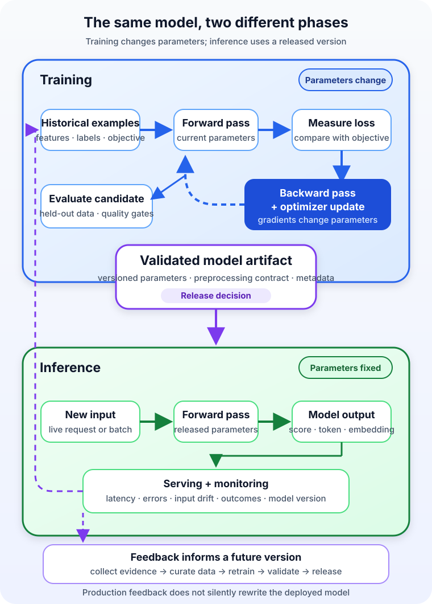

An email classifier works beautifully in a notebook. It has learned from years of labeled messages, survived evaluation, and appears ready for production.

Then the first real request arrives.

Should the application load the training dataset again? Does the model update itself after reading the message? Is every prediction another tiny training run?

No. The system has crossed an important boundary. **AI training is the process that uses data and an objective to adjust a model's parameters. AI inference is the process that uses a trained model to produce an output for new input.** Training creates or adapts the capability; inference applies it.

The same model architecture may appear in both phases, but the work, data, infrastructure, risks, and success metrics are different. Understanding that split makes AI systems much easier to design—and much harder to describe with misleading phrases such as “the AI learns from every request.”

## One model, two different jobs

Imagine a support team that wants to route incoming tickets to billing, account access, or technical support.

During **training**, the team provides historical tickets and the correct categories. The model makes predictions, a loss function measures how wrong those predictions are, and an optimization process changes the model's numerical parameters. This cycle repeats across many examples. The result is a candidate model artifact: learned parameters plus the information needed to reproduce its behavior.

During **inference**, a new ticket arrives without a known answer. The application applies the expected preprocessing, passes the ticket through a selected model version, and receives scores or a predicted category. The production request normally does not calculate a training loss, run backpropagation, or update the model's parameters.

[Google's supervised-learning guide](https://developers.google.com/machine-learning/intro-to-ml/supervised) separates the lifecycle into data, training, evaluation, and inference. The distinction also holds beyond simple classifiers. A language model is trained to learn parameters from data, then performs inference when it generates tokens for a prompt. An image model is trained to learn visual patterns, then performs inference when it labels or generates an image.

| Question | Training | Inference |
| --- | --- | --- |
| Primary purpose | Learn or adapt model parameters | Produce an output from a selected model |
| Typical input | Training examples, objectives, and configuration | New request or a batch of new records |
| Do parameters change? | Yes, as the optimizer updates them | Normally no; the deployed version stays fixed |
| Common outputs | Model artifact, metrics, checkpoints, and metadata | Prediction, score, embedding, classification, or generated content |
| Main engineering goals | Quality, reproducibility, convergence, and efficient throughput | Latency, throughput, availability, consistency, and cost per output |

The word *normally* matters. Online-learning systems can update a model from live data, but that is a deliberate architecture with its own validation, safety, and rollback requirements. It is not an automatic property of inference.

## What actually happens during training

Training begins before the first parameter update. A team must define the task, collect and prepare data, choose a model and objective, and split data so that evaluation is not merely a replay of the examples used to fit the model.

For a common neural-network training step, the model performs a **forward pass** to produce an output. A loss function compares that output with the desired result. A **backward pass** computes how parameter changes would affect the loss, and an optimizer applies an update. The process repeats over batches of examples.

The [Google Machine Learning glossary](https://developers.google.com/machine-learning/glossary) describes backpropagation as the backward pass that adjusts neural-network weights based on loss. Other model families use different learning algorithms, but the defining outcome is the same: training changes the learned model state.

Training also produces more than one final file. A trustworthy pipeline records the data and code versions, configuration, evaluation results, and model lineage. Checkpoints may preserve intermediate state so a long job can resume. Candidate models must be evaluated on appropriate data before one is approved for deployment.

This is why “the training job completed” is not equivalent to “the model is good.” A model can optimize the wrong target, memorize its training examples, learn leakage from information unavailable in production, or perform poorly for important groups and edge cases. Training creates a candidate. Evaluation supplies evidence for a release decision.

## Inference starts with a frozen decision

Inference begins after a particular model version has been selected. The model's learned parameters are loaded into memory, an input is transformed into the expected representation, and a forward computation produces an output. Application code may then apply thresholds, ranking, formatting, safety controls, or business rules.

That surrounding system matters. A fraud score does not decide by itself whether to block a payment. A generated answer does not authorize an account change. Inference supplies model output; deterministic software and policy decide what the product does with it.

Serving is related to inference but is not a synonym for the mathematical computation. **Inference** is the model producing an output. **Serving** is the operational system that makes inference available: model loading, endpoints, authentication, request routing, scaling, observability, and failure handling. [Azure Machine Learning's endpoint documentation](https://learn.microsoft.com/en-us/azure/machine-learning/concept-endpoints?view=azureml-api-2) makes this separation concrete by describing deployments as the compute and resources behind stable inference endpoints.

Inference can also happen in two broad operating modes:

- **Online inference** answers an interactive request, so tail latency, concurrency, timeouts, and availability matter.
- **Batch inference** processes accumulated records asynchronously, so total throughput, scheduling, restart behavior, and cost often matter more than a millisecond response.

The model may be identical in both modes. The serving architecture is not.

## Training and inference want different infrastructure

A training system is usually designed to move large datasets through repeated computations efficiently. Neural-network training must retain information needed for gradient calculation and may also hold optimizer state, so its memory profile can be much larger than a single forward pass. Distributed training adds synchronization, checkpointing, and recovery concerns.

An inference system is usually designed around the arrival pattern of real work. A mobile model may need to fit within a battery and memory budget. An online service may need autoscaling and predictable high-percentile latency. A nightly batch job may prefer inexpensive parallel throughput over always-on capacity.

It is therefore unsafe to assume that hardware chosen for training is automatically the best hardware for inference. Model size, precision, batching, accelerator support, response-time goals, traffic shape, and utilization all influence the answer. A single inference is often cheaper than a training run, but inference can become the larger lifetime expense when a model serves millions of requests.

[AWS's overview of the machine-learning workflow](https://docs.aws.amazon.com/sagemaker/latest/dg/how-it-works-mlconcepts.html) describes training, deployment, inference, monitoring, and retraining as a cycle. That lifecycle view is more useful than treating one expensive training job as the whole system.

## The feedback loop does not rewrite the live model

Production requests can create valuable feedback without changing the deployed model immediately.

Suppose users move incorrectly classified messages out of the spam folder. The system can log predictions, collect that later outcome, and add reviewed examples to a future dataset. A new training run produces a new candidate. Evaluation compares it with the current production version. Only after validation does deployment move traffic to the replacement.

[Google's guidance on ML pipelines](https://developers.google.com/machine-learning/managing-ml-projects/pipelines) recommends logging model predictions and, where possible, ground truth, while versioning training data and model metadata. It also separates the training pipeline from the validation and release decision.

This delayed loop is a feature, not needless bureaucracy. Immediate self-modification would make bad feedback, attacks, accidental labels, and transient behavior capable of changing production before anyone measured the consequence. Versioned retraining creates a place to test, approve, compare, and roll back.

Fine-tuning belongs on the training side of this boundary too. It begins with a pretrained model rather than random or newly initialized parameters, but it still adjusts parameters. Giving a model a longer prompt, retrieving a current document, or changing a sampling setting affects an inference request without fine-tuning the model.

## Watch the boundary for training-serving skew

A model can pass offline evaluation and still fail because production does not feed it the same kind of input.

Perhaps training represented prices in dollars while serving sends cents. Perhaps a feature was calculated with future information during training but is unavailable at prediction time. Perhaps the live population changes while the dataset remains frozen. These are forms of **training-serving skew**: the conditions used to develop the model differ from the conditions under which it performs inference.

[Google's production monitoring guidance](https://developers.google.com/machine-learning/crash-course/production-ml-systems/monitoring) recommends checking schema and feature skew and using only features that will exist at serving time. Shared transformation logic helps, but monitoring still needs to detect missing values, changed distributions, unusual outputs, latency, errors, and downstream outcomes.

Monitoring should not automatically conclude that every drift signal requires retraining. A data change may reveal a broken pipeline, a product change, fraud, seasonality, or a genuinely new population. First diagnose the change. Then decide whether to repair data, adjust serving logic, collect better examples, retrain, or retire the model.

## Common mistakes come from collapsing the phases

One mistake is claiming that a deployed model “keeps learning” when the system only stores conversations or adds context to later requests. Memory, retrieval, and parameter updates are different mechanisms.

Another is evaluating on the training data and calling the result production readiness. A model needs evidence on data that represents the task it will face, followed by monitoring after release.

A third is optimizing only model quality. The most accurate candidate may still be unusable if inference is too slow, expensive, fragile, or difficult to secure.

Finally, teams sometimes deploy a model file without versioning its preprocessing. If training tokenizes, normalizes, or orders features one way and serving does it another, the model receives a different problem from the one it learned.

## The practical takeaway

Training is where a model changes. Inference is where a chosen model version does work.

Between them sits the engineering that turns an experiment into a dependable product: evaluation, versioning, deployment, serving, monitoring, feedback collection, and controlled retraining. Keep those boundaries visible, and questions about cost, latency, data, safety, and responsibility become much easier to answer.

To place these phases in the wider field, read [Artificial Intelligence vs Machine Learning vs Deep Learning](/posts/ai-vs-machine-learning-vs-deep-learning/). For the mechanics of one important model family, continue with [What Is a Large Language Model?](/posts/what-is-a-large-language-model/). To compare where inference can run, see [on-device, cloud, and hybrid inference](/posts/android-intelligent-apps-cloud-hybrid-on-device-inference/).

## Sources

- [Google for Developers: Supervised Learning](https://developers.google.com/machine-learning/intro-to-ml/supervised)
- [Google for Developers: Machine Learning Glossary](https://developers.google.com/machine-learning/glossary)
- [Google for Developers: ML Pipelines](https://developers.google.com/machine-learning/managing-ml-projects/pipelines)
- [Google for Developers: Production ML Systems—Monitoring Pipelines](https://developers.google.com/machine-learning/crash-course/production-ml-systems/monitoring)
- [AWS: Overview of Machine Learning with Amazon SageMaker AI](https://docs.aws.amazon.com/sagemaker/latest/dg/how-it-works-mlconcepts.html)
- [Microsoft Learn: Endpoints for Inference in Production](https://learn.microsoft.com/en-us/azure/machine-learning/concept-endpoints?view=azureml-api-2)
