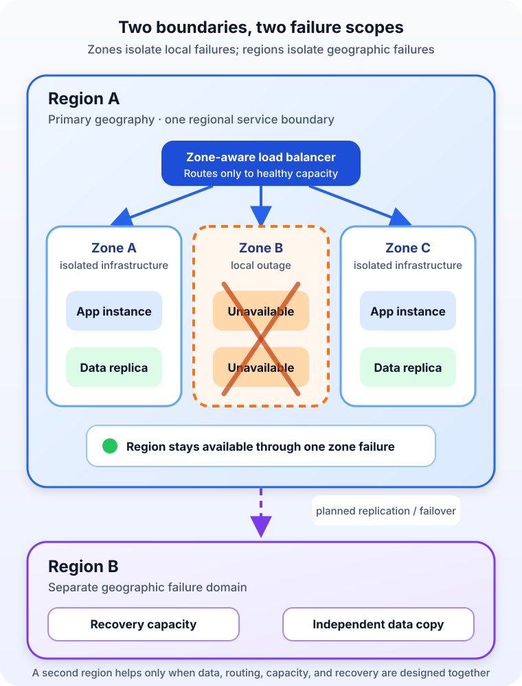

A team deploys its application to a cloud region, enables backups, and calls the system highly available.

Then one datacenter-scale failure takes out the application servers and the database together.

The team did choose a region. It did not choose more than one failure boundary inside that region.

This is why *region* and *availability zone* are not interchangeable location labels. **A cloud region is a broad geographic area in which a provider operates services. An availability zone is an isolated deployment area inside a region, designed to reduce the chance that one local infrastructure failure affects every copy of a workload.**

The difference sounds small in a console dropdown. In architecture, it decides what your system can survive.

## A region is the larger operating boundary

A cloud region is a provider-defined geographic area. It usually appears as a name or code such as `eu-west-1`, `West Europe`, or `europe-west1`.

Choosing a region affects much more than the map pin shown in the console. It can determine:

- How close the application is to its users
- Where regulated or sensitive data is stored and processed
- Which services, machine types, and accelerators are available
- The prices and network-transfer charges that apply
- The failure scope your disaster-recovery plan must consider

[AWS describes Regions as separate geographic areas](https://docs.aws.amazon.com/AWSEC2/latest/UserGuide/using-regions-availability-zones.html) and does not automatically replicate regional resources into other Regions. [Google Cloud similarly describes regions as independent geographic areas made up of zones](https://docs.cloud.google.com/compute/docs/regions-zones). Azure calls a region a geographic perimeter containing a set of datacenters.

The exact engineering and terminology differ among providers. The useful shared idea is that a region is a large location boundary for service placement, governance, and failure planning.

That last point matters. Putting a database in one region does not quietly produce a recoverable database in another. Cross-region copies, traffic routing, credentials, capacity, and failover behavior must come from a service feature or from your architecture.

## An availability zone is a failure-isolation boundary

An availability zone sits inside a region. It may contain one datacenter or a group of datacenters, depending on the provider, but it is designed to be isolated from the region's other zones.

[Azure documents independent power, cooling, and networking infrastructure for its availability zones](https://learn.microsoft.com/en-us/azure/reliability/availability-zones-overview). AWS calls its zones isolated locations within a Region. Google Cloud tells architects to consider a zone a single failure domain within a region.

Zones in the same region are also connected for fast communication. That combination is their purpose: far enough apart to reduce shared local failures, close enough for many applications to replicate data and serve traffic across zones without the penalties of a distant region.

An availability zone is not the same thing as one building, and a region is not simply one enormous datacenter. Both are logical cloud abstractions over physical infrastructure. What architects should rely on is the documented isolation and service behavior, not an imagined floor plan.

| Question | Region | Availability zone |
| --- | --- | --- |
| What is it? | A broad geographic service area | An isolated deployment area inside a region |
| What choice does it mainly shape? | Latency, data location, service access, and regional recovery | Placement and resilience against local infrastructure failure |
| What can it help a design survive? | A regional failure, only when another region is deliberately used | A zone failure, only when resources actually span zones |
| Typical tradeoff | Greater distance, replication delay, cost, and operational complexity | Extra replicas, cross-zone traffic, and distributed-state complexity |

The word *only* in that table carries most of the lesson. A provider offering three zones does nothing for an application that keeps every critical component in one of them.

## Selecting a zone is not the same as using multiple zones

Imagine an order API with two application instances and one database. All three run in Zone A.

The system has redundant application processes, but not redundant placement. If Zone A becomes unavailable, both application instances and their database disappear from the request path together. More copies inside one failure domain protect against process or host failures, not the loss of that domain.

A multi-zone design changes the shape:

1. A zone-aware load balancer can send requests to healthy application instances in Zones A and B.
2. The data tier stores or replicates state across zones using a service mode designed for zone failure.
3. Health checks remove an unhealthy target without depending on the failed zone.
4. Capacity in the surviving zone is sufficient to carry the required load.

The fourth point is easy to miss. A system spread evenly across three zones may lose one-third of its capacity when a zone fails. If the remaining instances are already busy, the architecture is geographically redundant but operationally unable to absorb the failure.

Managed services can hide some of this machinery. Azure, for example, distinguishes *zonal* resources pinned to a chosen zone from *zone-redundant* resources that the service distributes across zones. Google Cloud distinguishes zonal, regional, and global resources; a zonal disk and VM normally need compatible placement, while a regional resource is usable across zones in its region.

Always ask about the specific resource, not just the provider: **Is it zonal, regional, or global, and who performs replication and failover?**

## Multi-zone availability is not multi-region recovery

Multiple zones reduce the blast radius of failures such as a local power, cooling, network, cluster, or facility problem. They do not place the workload outside the region.

A region-wide disruption has a larger scope. So can an error that is faithfully copied across every zone: a destructive deployment, invalid configuration, compromised credential, or accidental data deletion. Geographic redundancy cannot replace change controls, immutable backups, or tested restoration.

This creates a useful architectural distinction:

- **Multi-zone design is commonly the first line of high availability.** It keeps a production service running through the loss of one zone inside its region.
- **Multi-region design supports regional resilience, disaster recovery, or global delivery.** It places deployable capacity and data in a separate geographic failure domain.

That does not mean every application should run active-active in several regions. A second region introduces another distributed system: data must be replicated, traffic must be redirected, configuration must remain consistent, and operators must understand failover and failback.

[Microsoft's current region and availability-zone guidance](https://learn.microsoft.com/en-us/azure/well-architected/design-guides/regions-availability-zones) recommends starting with business requirements such as recovery time objective (RTO), recovery point objective (RPO), latency, data residency, cost, and operational complexity. That is a better starting point than choosing the architecture with the most boxes.

## The data tier decides whether failover is real

Stateless application servers are usually the easy part. If one disappears, another can accept a request.

State is harder. Suppose an order is acknowledged in Zone A, but the newest database record has not reached Zone B when A fails. The application may be reachable while the order is missing. If both zones accept writes during a partition, the system also needs rules for consistency and conflict resolution.

Within a region, some managed databases and storage products offer synchronous zone replication. A write is not complete until the required copies confirm it. This can reduce data loss during a zone failure, but the actual guarantee, latency, quorum behavior, and failover process are service-specific.

Across regions, replication is often asynchronous because distance makes every round trip more expensive. That creates a possible gap between the latest committed write and the latest remote copy. The acceptable gap becomes the RPO; the time needed to redirect traffic, promote data, and restore dependencies contributes to the RTO.

Do not infer those objectives from a marketing label. Read the service documentation, record the expected behavior, and test a failure path that includes the database, queues, object storage, secrets, DNS, and external dependencies—not only the web servers.

## Choose the region before choosing the zones

Region selection should begin with constraints. Where are the users? Where may the data live? Does the region offer every required service and feature? Are the necessary instance types, quotas, and zone-aware modes available? What will cross-zone and cross-region traffic cost?

Only then does zone placement become meaningful.

For a typical production web application, a sensible progression looks like this:

- Start with one suitable region and make application and data tiers resilient across its zones.
- Keep backups independent of the live workload and rehearse restoration.
- Define RTO and RPO with the business rather than guessing them from technology.
- Add another region when regional outage risk, global latency, capacity, or recovery objectives justify the cost and complexity.
- Test zone and regional failure procedures before an incident makes the first attempt for you.

This progression is not a universal template. A development environment may accept a single zone. A public safety service may require several zones in several regions. A regulated workload may be prohibited from copying data to the region an engineer would otherwise choose.

Architecture begins by naming the failure you need to survive.

## Common mistakes hide in the boundaries

The most common mistake is treating the region name as proof of resilience. It says where a resource lives, not how many independent copies exist.

Another is spreading compute across zones while leaving the database, NAT path, queue, or other critical dependency in one zone. The application is only as available as the dependency that all requests still need.

A third is assuming that *managed* means *multi-zone*. Some services are zone-redundant automatically, some require a higher tier or explicit setting, and some remain zonal. Support can also vary by region.

Finally, teams sometimes add a second region without planning data behavior. An idle server elsewhere is not disaster recovery if it cannot obtain trustworthy data, receive traffic, or authenticate users when the primary region is unavailable.

## The practical takeaway

A region answers **which broad geographic cloud location should host this workload?** An availability zone answers **which isolated location inside that region should host this resource?**

Use multiple zones when a workload must continue through a zone failure. Use multiple regions when the requirements justify protection from regional loss, recovery in another geography, or service closer to distant users. In both cases, redundancy works only when every critical path—traffic, compute, data, identity, and operations—crosses the intended boundary.

If the larger cloud model is still fuzzy, start with [what cloud computing means](/posts/what-is-cloud-computing/), then compare [IaaS, PaaS, and SaaS responsibilities](/posts/iaas-vs-paas-vs-saas/) and [public, private, and hybrid cloud deployment models](/posts/public-cloud-vs-private-cloud-vs-hybrid-cloud/).

## Sources

- [AWS: Regions and Zones](https://docs.aws.amazon.com/AWSEC2/latest/UserGuide/using-regions-availability-zones.html)
- [Microsoft Azure: What are availability zones?](https://learn.microsoft.com/en-us/azure/reliability/availability-zones-overview)
- [Microsoft Azure Well-Architected Framework: Using availability zones and regions](https://learn.microsoft.com/en-us/azure/well-architected/design-guides/regions-availability-zones)
- [Google Cloud: Regions and zones](https://docs.cloud.google.com/compute/docs/regions-zones)
