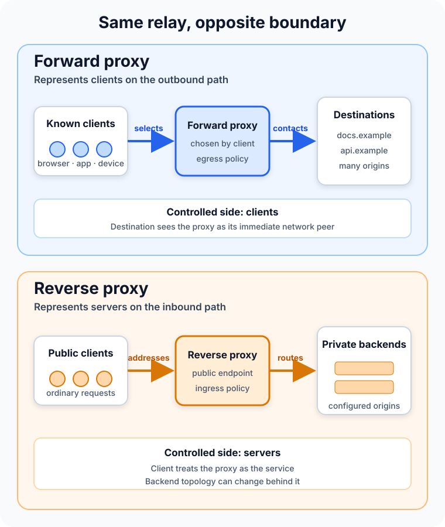

A developer opens a website from a company laptop. The site sees a corporate IP address instead of the laptop's address. Later, a customer opens that company's application, but the request reaches an edge server instead of the application process that generates the page.

Both requests passed through a proxy. The arrows even look similar. Yet the two proxies solve opposite boundary problems.

A **forward proxy acts on behalf of clients**. A client or its network sends outbound traffic to the proxy, which chooses or contacts the destination. A **reverse proxy acts on behalf of servers**. A public client addresses the proxy as the service, and the proxy selects a private backend.

The fastest way to tell them apart is not to ask where the box sits. Ask **who chose it, which side it represents, and whether the client intended to reach the proxy or the origin behind it**.



## The same middle position hides two different relationships

HTTP calls both designs intermediaries, but the protocol gives them different roles. [RFC 9110](https://www.rfc-editor.org/rfc/rfc9110.html#section-3.7) defines a proxy as a forwarding agent chosen by the client, usually through local configuration. It defines a gateway, also called a reverse proxy, as an intermediary that appears to be the origin server on its client-facing connection and forwards requests to other servers.

That distinction is more useful than the names suggest.

With a forward proxy, the browser, operating system, application, or network knows it is using an outbound intermediary. It might be configured with a proxy address, a proxy auto-configuration file, or an organization-wide routing policy. The destination can vary from one request to the next.

With a reverse proxy, the public hostname resolves to the intermediary. The browser makes an ordinary request to `app.example.com`; it does not need to know that the proxy may send `/api` to one service and `/images` to another. The allowed backends come from server-side configuration.

Direction is therefore a matter of **control and representation**, not east versus west on a diagram. The same product—and sometimes the same running server—can support both modes when configured to do so. Apache HTTP Server's [proxy module documentation](https://httpd.apache.org/docs/current/mod/mod_proxy.html#forwardreverse) describes both roles explicitly.

## A forward proxy controls the client's way out

Imagine 500 employee devices on a private network. Instead of allowing each device to connect directly to arbitrary Internet services, the organization directs web traffic through an outbound proxy.

For an ordinary HTTP request, the client can send the proxy a request that names the full target URI. The proxy applies policy, resolves and contacts the destination, then returns the response. The destination normally sees the proxy's network connection as the immediate source.

This creates one useful control point for:

- authenticating users or managed devices;
- allowing or denying destinations;
- logging outbound web access;
- scanning content where policy and encryption permit it;
- caching reusable responses;
- giving a group of clients a controlled egress address.

The proxy does not magically make clients anonymous. It knows which client connected, logs may preserve that identity, and forwarded metadata or application-level identifiers can reveal it to the destination. “The origin sees the proxy's IP address” is a narrow network fact, not a complete privacy guarantee.

Forward proxies also need strict access control. An accidentally public forward proxy can be abused to relay other people's traffic, conceal its source, and consume the operator's resources. Apache warns administrators not to enable forward proxying until only authorized clients can use it.

## HTTPS usually creates a tunnel, not a readable HTTP conversation

Plain HTTP lets a forward proxy receive and forward HTTP messages. HTTPS adds an encrypted connection between the client and the destination, so the common flow changes.

The client can send the proxy an HTTP `CONNECT` request naming a host and port. If policy allows it, the proxy opens a TCP connection to that destination and relays bytes in both directions. The client then performs TLS through the tunnel. [MDN's proxy and tunneling guide](https://developer.mozilla.org/en-US/docs/Web/HTTP/Guides/Proxy_servers_and_tunneling#http_tunneling) describes `CONNECT` as the mechanism that begins this two-way communication.

In that design, the proxy can control the requested host and port and observe connection metadata, but it cannot read the encrypted HTTP paths, headers, or bodies flowing inside the tunnel.

TLS inspection is a different architecture. An organization-managed proxy can terminate one TLS connection and create another, but the client must trust the organization's certificate authority. That choice changes the security and privacy boundary, can break certificate pinning or mutual TLS, and requires careful key handling and explicit governance. It should not be described as a routine side effect of “using a proxy.”

## A reverse proxy controls the server's way in

Now look at the same path from the service owner's side.

DNS maps `shop.example.com` to a reverse proxy. The client establishes a connection to that public endpoint and sends a normal request. The proxy terminates or passes the connection, applies routing and policy, contacts a configured backend, and returns the result under the public service's identity.

This gives the service one deliberate ingress boundary for concerns such as:

- TLS termination and certificate management;
- path, hostname, or header-based routing;
- load balancing and health-aware backend selection;
- authentication, rate limits, or web application firewall rules;
- compression, buffering, and caching;
- hiding backend addresses and changing the server pool independently.

The defining feature is not any one of those capabilities. It is that clients address the proxy as the service while the proxy knows the backend topology. NGINX's [reverse proxy documentation](https://docs.nginx.com/nginx/admin-guide/web-server/reverse-proxy/) shows this relationship with `proxy_pass`: NGINX receives a request, sends it to a configured server, fetches the response, and returns it to the client.

A reverse proxy can therefore be a load balancer, but the terms are not synonyms. A reverse proxy may always use one backend. A load balancer may distribute non-HTTP connections without acting as an HTTP gateway. The role tells you what boundary is being represented; the feature tells you what decision is made there.

## Forward proxy vs reverse proxy at a glance

| Question | Forward proxy | Reverse proxy |
| --- | --- | --- |
| Which side does it represent? | Clients making outbound requests | Servers receiving inbound requests |
| Who configures or selects it? | The client, device administrator, or client network | The service owner or platform team |
| What does the requester name? | Usually the desired external destination | The public service hosted by the proxy |
| What can remain hidden? | Client network addresses and topology | Backend addresses and topology |
| Typical jobs | Egress control, filtering, access policy, shared caching | Ingress routing, TLS, load balancing, protection, caching |
| Main configuration danger | Becoming an unauthorized open proxy | Trusting spoofed forwarding headers or exposing backends |

Caching appears in both columns because cache placement does not define proxy direction. A forward proxy can reuse responses for its clients; a reverse proxy can protect its origins from repeated work. Authentication, filtering, and logging can also exist on either side. Ownership of the route is the durable distinction.

## The original address becomes data, not the connection source

Once a proxy opens a new connection, the next hop sees the proxy as its peer. If the application needs the original client's address, scheme, or host, that context must be carried separately.

The standardized [`Forwarded` header](https://www.rfc-editor.org/rfc/rfc7239.html) can convey information lost when a proxy participates in the request path. Deployments also commonly use `X-Forwarded-For`, `X-Forwarded-Host`, and `X-Forwarded-Proto`.

Those headers are trustworthy only when a known proxy removes or overwrites untrusted values and the application accepts them solely from that proxy. A public client can send an `X-Forwarded-For` header too. If an application blindly treats its leftmost value as authenticated network identity, IP-based access rules and audit records become easy to deceive.

The same principle applies to bypass paths. A reverse proxy cannot enforce authentication, rate limits, or TLS policy if clients can also reach the backend directly. Protect the backend network, authenticate the proxy-to-backend hop when appropriate, and document which component is allowed to assert forwarded context.

## A proxy is not automatically a VPN

A forward proxy and a [VPN](/posts/what-is-a-vpn/) can both change the apparent source of traffic and route it through another system, but their boundaries differ.

A typical application proxy handles selected protocols or requests from proxy-aware software. A VPN creates a network-layer path and can route traffic from many applications without each one understanding HTTP proxy semantics. Proxy auto-configuration can even choose a proxy for some URLs and a direct path for others; a VPN instead follows operating-system routing rules.

Neither label tells you whether traffic is encrypted end to end, logged, filtered, or private from the intermediary. Those properties come from the protocol, configuration, trust model, and operator—not from the marketing name.

## Troubleshoot the path one hop at a time

Proxy failures feel mysterious when the system is treated as one connection. It is usually two connections and several independent decisions.

For a forward proxy, check whether the client selected the expected proxy, whether proxy authentication succeeded, whether the destination and port are permitted, whether DNS resolution occurs on the intended side, and whether `CONNECT` is allowed for the target. A direct request succeeding does not prove the proxy route works.

For a reverse proxy, check public DNS and client-to-proxy TLS first. Then check route matching, backend name resolution, health status, proxy-to-backend connectivity, timeouts, and the backend's response. A `502 Bad Gateway` typically means the gateway did not obtain a valid upstream response; a `504 Gateway Timeout` means the gateway did not receive one in time. Both identify the hop that reported failure, not the underlying cause.

Draw the actual path and attach evidence to each edge:

```text
client -> selected proxy -> destination       # forward proxy
client -> public reverse proxy -> backend     # reverse proxy
```

Then ask who owns DNS, TLS, authentication, policy, and timeouts for each arrow. This is far more reliable than changing proxy settings until the error disappears.

## Which one should you use?

Use a forward proxy when you need a controlled outbound path for a known set of clients: corporate web access, workload egress policy, destination allowlists, or a stable egress identity.

Use a reverse proxy when you need a controlled inbound path for services: one public endpoint, backend routing, TLS termination, load distribution, or protection at the edge. Read [the dedicated reverse proxy guide](/posts/what-is-a-reverse-proxy/) for a deeper look at request headers, caching, gateway errors, and API gateway overlap.

Many production systems use both. An internal service may send outbound requests through an egress proxy while receiving inbound requests through a reverse proxy. Between them, [load balancing](/posts/what-is-load-balancing/) may distribute work across multiple instances. The design is not contradictory; each intermediary owns a different boundary.

## The takeaway

Forward and reverse proxies both relay traffic, but they do not face the same customer.

A forward proxy is chosen for clients and controls how they reach destinations. A reverse proxy is deployed for servers and controls how clients reach backends. Features such as caching, filtering, TLS, and load balancing can overlap, so they are poor definitions by themselves.

When the labels become confusing, follow the request. Identify who selected the intermediary, what hostname the client believes it is contacting, which destinations the intermediary may choose, and which side's topology it hides. The direction will become clear—and so will the security boundary that needs protection.

## Continue learning

- [What Is a Reverse Proxy and How Does It Work?](/posts/what-is-a-reverse-proxy/)
- [What Is Load Balancing and How Does It Work?](/posts/what-is-load-balancing/)
- [What Is a VPN and How Does It Work?](/posts/what-is-a-vpn/)
- [What Is a REST API and How Does It Work?](/posts/what-is-a-rest-api/)

## Sources

- [RFC 9110: HTTP Semantics](https://www.rfc-editor.org/rfc/rfc9110.html)
- [RFC 7239: Forwarded HTTP Extension](https://www.rfc-editor.org/rfc/rfc7239.html)
- [Apache HTTP Server: mod_proxy](https://httpd.apache.org/docs/current/mod/mod_proxy.html)
- [NGINX Documentation: Reverse Proxy](https://docs.nginx.com/nginx/admin-guide/web-server/reverse-proxy/)
- [MDN: Proxy Servers and Tunneling](https://developer.mozilla.org/en-US/docs/Web/HTTP/Guides/Proxy_servers_and_tunneling)
