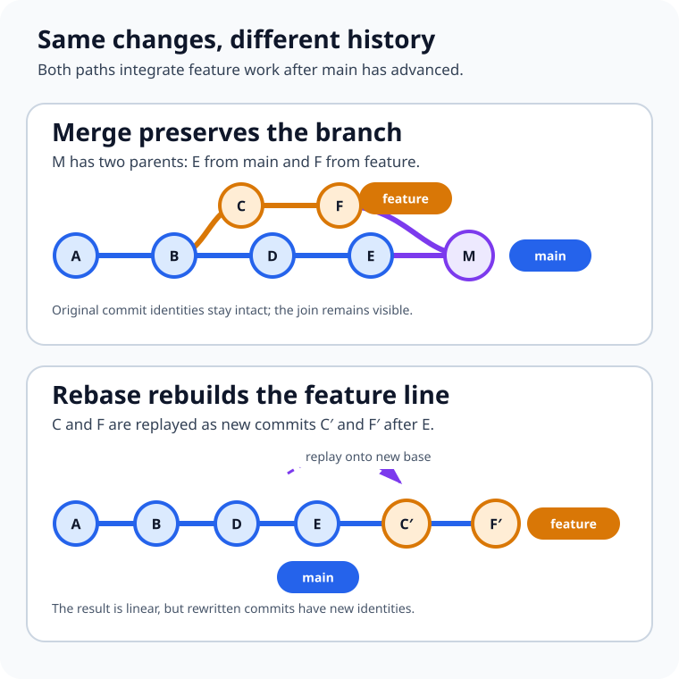

Your feature branch was current yesterday. This morning, `main` has six new commits, the pull request shows a fork in the road, and someone says, “Just rebase it.” Someone else says, “Never rebase—merge is safer.”

Both pieces of advice are incomplete.

**Git merge joins histories without replacing the commits that already exist. Git rebase takes selected commits, replays their changes on a new base, and creates new commits.** Both can produce the same final files. They tell different stories about how those files arrived there.

That is the real Git merge vs rebase decision: not which command is universally better, but whether this moment calls for preserving history or rewriting a private part of it.



## A branch is a name pointing to a commit

The commands become less mysterious when you stop imagining branches as folders.

A Git commit records a snapshot plus metadata and a link to its parent commit or parents. A branch is a movable name pointing at one commit. As new commits are added, that name moves forward. Git's official explanation of [branches and commits](https://git-scm.com/book/en/v2/Git-Branching-Branches-in-a-Nutshell) builds from this same model.

Suppose `main` and `feature` share commit `B`, then diverge:

```text
          C---F  feature
         /
A---B---D---E    main
```

The feature contains changes in `C` and `F`. Main contains changes in `D` and `E`. Integration must reconcile those lines of work. Merge does that by joining them. Rebase does it by moving the feature work to a new starting point.

## Merge adds a relationship to the history

While `main` is checked out, this command integrates `feature`:

```bash
git switch main
git merge feature
```

Because the branches diverged, a normal merge creates a commit with two parents: the previous tip of `main` and the tip of `feature`. The original feature commits keep their identities and relationships. The graph records that the two lines of development existed independently and were joined.

The [official `git merge` reference](https://git-scm.com/docs/git-merge) describes this as a true merge. Git finds a merge base—usually the best common ancestor—and performs a three-way comparison between that base and the two branch tips. If both sides changed the same area incompatibly, Git stops for a human decision.

Not every merge creates a merge commit. If `main` has not advanced since `feature` branched, Git can simply move the `main` pointer forward. That is a **fast-forward**. The snapshots do not need reconciling because the feature tip already contains the entire path from the old `main` tip.

Three options make that policy explicit:

- `git merge --ff feature` fast-forwards when possible and otherwise creates a merge commit.
- `git merge --no-ff feature` records a merge commit even when a fast-forward is possible.
- `git merge --ff-only feature` succeeds only when Git can fast-forward; it refuses divergent history.

A merge commit can make a feature boundary visible, which is valuable when the group of commits matters as a unit or when a long-lived branch will be merged repeatedly. The cost is a graph with more branches and joins. That complexity is not automatically bad; sometimes it is the most honest and useful record of collaboration.

## Rebase changes where commits appear to begin

Now start from the same divergent graph, but check out `feature` and run:

```bash
git switch feature
git rebase main
```

Git identifies the commits unique to `feature`, temporarily sets them aside, moves the branch to the tip of `main`, and replays those changes one by one. The [official `git rebase` reference](https://git-scm.com/docs/git-rebase) describes the replay as similar to applying a sequence of cherry-picks.

The old `C` and `F` do not move. Git creates `C'` and `F'`: new commits with new parents and therefore new object identities. The files may end up with the same content, but the history is different.

```text
A---B---D---E---C'---F'  feature
            main^
```

Now `feature` is a direct descendant of `main`. Integrating it can be a fast-forward:

```bash
git switch main
git merge --ff-only feature
```

This produces a linear graph, which can make `git log`, `git bisect`, and step-by-step review easier to follow. Rebase also lets a developer clean up a private branch with interactive rebase before sharing it. But the neatness comes from reconstruction: the rewritten commits are replacements, not the original objects wearing new dates.

## Merge and rebase answer different questions

| Question | Merge | Rebase |
| --- | --- | --- |
| What happens to existing commits? | They remain in place | Selected commits are replayed as new commits |
| Is divergence visible afterward? | Usually yes, through a merge commit | No; the replayed branch appears to start from the new base |
| Can it change commit IDs? | Existing commit IDs remain; a merge may add one commit | Yes, every replayed commit gets a new identity |
| Where might conflicts occur? | During the merge operation | During replay, potentially at more than one commit |
| Best default use | Integrating shared or meaningful branch history | Updating and cleaning private, unpublished work |
| Typical risk | A noisy graph if merges are made mechanically | Disrupting collaborators if published commits are rewritten |

Neither method removes the underlying content conflict. If two branches make incompatible changes to the same lines, Git still needs help. Rebase may surface that disagreement commit by commit because it replays each change separately. Merge usually presents the combined conflict once at the merge point.

That difference can change the experience, but not the fundamental work: someone must understand the intended result, edit the file, and verify it.

## The safest rule is about ownership, not branch names

You may have heard, “Never rebase `main`.” That is useful shorthand, but the deeper rule is broader:

**Do not rewrite commits that other people may already be using unless the team has explicitly coordinated the rewrite.**

If a colleague based work on your published commit `C`, and you replace it with `C'`, their history still refers to `C`. Reuniting the two versions can create duplicate-looking commits, confusing pull requests, and force-push coordination. The official Git book's [rebasing guidance](https://git-scm.com/book/en/v2/Git-Branching-Rebasing) warns specifically about rebasing commits that have been pushed and become a basis for other work.

By contrast, rebasing your own local feature branch before anyone depends on it is usually low-risk. You own both the old and replacement history. Many teams therefore use a practical hybrid:

1. Fetch the current remote state.
2. Rebase a private feature branch onto `origin/main`.
3. Run tests and review the rewritten commits.
4. Integrate through the repository's chosen pull-request policy.

This keeps local work readable without pretending shared history is disposable.

## A practical rebase workflow

Assume your changes are committed and the working tree is clean. Update remote-tracking information first; `git fetch` does not rewrite your local branch.

```bash
git fetch origin
git switch feature/report-export
git rebase origin/main
```

If Git stops at a conflict, inspect and edit the affected files. Then stage the resolved version and continue:

```bash
git status
git add path/to/resolved-file
git rebase --continue
```

Repeat if a later commit conflicts. If the rebase is heading in the wrong direction, return the branch to its pre-rebase state:

```bash
git rebase --abort
```

The rebase documentation also offers `git rebase --skip`, but skipping means omitting the current commit's change. Do not use it merely to silence a conflict; first confirm that the change is already present or genuinely unnecessary.

After a successful rebase, inspect the result and run the relevant test suite. If the old branch was already pushed, updating it normally requires a force update. `--force-with-lease` is safer than unconditional `--force` because it refuses to overwrite a remote value you did not expect—but a safer force push is still a history rewrite that should match team policy.

## A practical merge workflow

When the branch history should remain intact, update `main` and merge deliberately:

```bash
git fetch origin
git switch main
git merge --ff-only origin/main
git merge --no-ff feature/report-export
```

If conflicts appear, resolve them, stage the files, and finish the merge with `git commit`. To abandon the in-progress operation, use:

```bash
git merge --abort
```

Git's [`pull` documentation](https://git-scm.com/docs/git-pull) is worth reading because `git pull` combines fetching with integration. Depending on its options and configuration, that integration may be a fast-forward, rebase, merge, or squash. Separating `git fetch` from the integration command makes the decision visible and reduces surprises while learning.

## Squash is a third policy, not a synonym for rebase

Pull-request platforms often offer **squash and merge**. A squash takes the net change from a branch and records it as one ordinary commit on the target branch. It does not preserve the feature commits as ancestors, and it does not replay each feature commit the way a normal rebase does.

Squashing is useful when the branch contains many “fix typo” or “address review” commits that have little long-term value. It is less suitable when the sequence itself explains an important migration or when two long-lived branches will be merged repeatedly. Git's [merge and rebase FAQ](https://git-scm.com/docs/gitfaq#Documentation/gitfaq.txt-MergingandRebasing) notes that repeated squash merges between long-lived branches can leave the merge base unchanged and cause old conflicts to be reconsidered.

## Common mistakes are really policy mistakes

The first mistake is rebasing only because a graph looks untidy. A readable history helps, but appearance alone does not justify breaking references held by people, automation, review comments, or release tooling.

The second is believing rebase prevents conflicts. It changes when and how conflicts are presented; it cannot make incompatible edits compatible.

The third is treating `git pull` as a harmless download. It fetches and then integrates. Use an explicit option—or fetch first—so you know whether history will merge, rebase, squash, or only fast-forward.

The fourth is resolving a conflict without testing the result. Git can confirm that the text is syntactically resolved. It cannot confirm that the combined behavior is correct.

Finally, do not mix a history-policy change into the middle of urgent delivery. Decide whether the repository prefers merge commits, rebased fast-forwards, or squash commits before a pressured pull request makes the choice for you. Protected branches and pull-request settings can then enforce the shared rule.

## The practical takeaway

Choose **merge** when preserving the real branch relationship matters, when commits are already shared, or when integration history is useful. Choose **rebase** when you own the unpublished commits and want to place them cleanly on a newer base. Choose **squash** when the feature's final change matters more than its internal commit sequence.

The final files are only half the result. The other half is the history future developers will debug, review, revert, and trust.

## Continue learning

- [What Is Software Architecture? A Beginner's Guide](/posts/software-architecture-beginners-guide/)
- [Unit Testing vs Integration Testing vs End-to-End Testing](/posts/unit-testing-vs-integration-testing-vs-end-to-end-testing/)
- [How to Audit GitHub Actions Token Permissions](/posts/audit-github-actions-token-permissions/)

## Sources

- [Git documentation: git merge](https://git-scm.com/docs/git-merge)
- [Git documentation: git rebase](https://git-scm.com/docs/git-rebase)
- [Git documentation: git pull](https://git-scm.com/docs/git-pull)
- [Pro Git: Git Branching—Rebasing](https://git-scm.com/book/en/v2/Git-Branching-Rebasing)
- [Git FAQ: Merging and Rebasing](https://git-scm.com/docs/gitfaq#Documentation/gitfaq.txt-MergingandRebasing)
