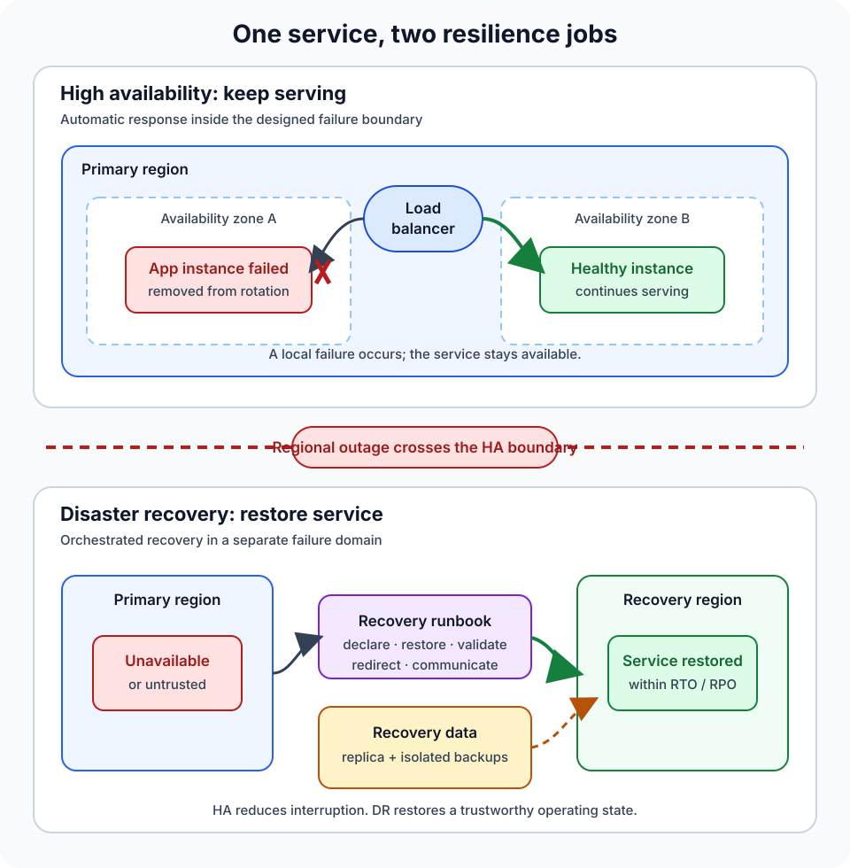

The application has three servers, a load balancer, and a database replica. One server fails, traffic moves elsewhere, and nobody notices.

Then an operator deletes the wrong production data. The database faithfully replicates the deletion to every live copy.

The architecture was available. It was not recoverable.

That is the tension between high availability and disaster recovery. **High availability keeps a service usable through failures the running system is designed to absorb. Disaster recovery restores an acceptable service after a larger or different disruption crosses that design boundary.**

They share tools—replication, health checks, redundant infrastructure, automation—but solve different moments in a failure. A reliable system often needs both.

## High availability protects the service that is running now

High availability, or HA, is a property of normal production operation. The system expects some components to fail and continues serving users, perhaps with less capacity or limited features.

A typical highly available web application might have:

- multiple application instances rather than one server;
- a load balancer that stops routing to unhealthy instances;
- data replicas across separate failure domains;
- automatic restart, leader election, or failover;
- enough spare capacity to carry the workload after a failure.

[Google Cloud describes availability as the fraction of time a service is usable](https://docs.cloud.google.com/architecture/scalable-and-resilient-apps) and summarizes the common HA pattern as distributed compute, load balancing, and replicated data. The important word is *system*. Three application servers do not make a service highly available if they all depend on one database, one network path, or one identity service.

HA therefore starts with a failure boundary. A deployment might be designed to survive the loss of a process, virtual machine, rack, or availability zone. When a failure stays inside that boundary, detection and failover should usually be fast and automated.

This is why [load balancing](/posts/what-is-load-balancing/) matters but is not sufficient. A load balancer can remove a failed web server from rotation. It cannot recover data that was corrupted everywhere, recreate a missing region, or decide whether a security incident is safe to fail over from.

## Disaster recovery begins when the normal design is no longer enough

Disaster recovery, or DR, plans for events that make the primary operating environment unusable or untrustworthy. A regional outage is the obvious example, but disasters are not limited to damaged infrastructure. A destructive deployment, compromised administrator, ransomware incident, or replicated data corruption can leave every healthy-looking live replica in the wrong state.

DR asks a different question: **How will the business restore an acceptable service, data state, and operating environment?**

The answer may involve a second region, a warm standby, infrastructure-as-code templates, immutable backups, alternate credentials, manual approval, and a documented runbook. Unlike routine HA failover, DR may deliberately involve people. Someone might need to declare the disaster, isolate compromised systems, choose a safe recovery point, validate data, redirect traffic, and later coordinate failback.

[Microsoft's reliability guidance](https://learn.microsoft.com/en-us/azure/reliability/concept-business-continuity-high-availability-disaster-recovery) makes this operational distinction explicit: HA addresses regular transient faults and intermittent failures, while DR plans for rare, severe events and often combines automated and manual controls.

The line is not determined by a product name or a map. A second availability zone can be part of HA for a service that needs automatic recovery in seconds, or part of DR for a less critical system that accepts a manual recovery measured in hours. The failure scope, recovery objectives, and operating process define the role.

## The difference in one table

| Question | High availability | Disaster recovery |
| --- | --- | --- |
| Primary goal | Keep the service usable during expected failures | Restore acceptable service after a major disruption |
| Typical state | Multiple production components are already running | Recovery capacity may be active, warm, cold, or created on demand |
| Common trigger | Instance, process, disk, or zone failure inside the design boundary | Region loss, widespread corruption, cyber incident, or primary-site loss |
| Response | Usually automated health detection and failover | Orchestrated recovery that may require a disaster declaration and people |
| Main measures | Availability SLO, error rate, latency, failover behavior | Recovery time objective, recovery point objective, integrity, and recovery completeness |
| Essential proof | Fault and load tests show service continues | A recovery exercise restores the whole service and its dependencies |

This comparison is useful, but it is not a wall between two technologies. AWS notes that availability and DR both use monitoring, multiple locations, and automatic failover. Its [Well-Architected disaster-recovery guidance](https://docs.aws.amazon.com/wellarchitected/latest/reliability-pillar/plan-for-disaster-recovery-dr.html) distinguishes them by focus: availability protects workload components, while DR considers separate copies of the workload and the time required to recover.

## RTO and RPO turn “recover quickly” into requirements

A DR plan needs two time-based objectives.

**Recovery time objective (RTO)** is the maximum acceptable recovery period. If checkout has an RTO of 30 minutes, the organization is saying that a disaster response must restore the defined checkout service within that window. The [NIST glossary definition of RTO](https://csrc.nist.gov/glossary/term/recovery_time_objective) connects that recovery time to the point at which the outage harms the organization's mission or business processes.

**Recovery point objective (RPO)** describes the acceptable data-loss window. An RPO of five minutes means recovery must reach a data state no more than five minutes behind the disruption. NIST defines the [recovery point objective](https://csrc.nist.gov/glossary/term/recovery_point_objective) as the point in time to which data must be recovered after an outage.

These are objectives, not promises created by writing them in a document. The architecture and exercises must demonstrate that they are achievable.

Suppose orders are copied asynchronously to a second region every minute. That might support a low RPO for a regional infrastructure failure. It does not guarantee safety from a bad update that immediately propagates to both regions. Point-in-time backups or an isolated recovery copy may still be necessary.

RTO and RPO also belong to business flows, not merely servers. Restoring virtual machines in ten minutes does not satisfy the RTO if DNS still points to the failed site, secrets are unavailable, the payment provider rejects the new egress address, or nobody can confirm which orders completed.

## Backups are necessary, but a backup is not a DR plan

A backup is a recoverable copy of data. Disaster recovery is the tested capability to restore the service around that data.

The difference appears as soon as someone asks practical questions:

- Can the backup be reached when the primary account or region is unavailable?
- Is it isolated from the credentials that could delete production?
- Has restoration been tested at the real data volume?
- Which application version and schema can read the restored data?
- How are networks, identities, certificates, secrets, and DNS recreated?
- Who validates the result and authorizes traffic to return?

A nightly backup may support an RPO near 24 hours, but only if it completes, is retained, and can be restored. Its RTO could be much longer if transferring, loading, checking, and reconnecting the data takes hours.

[Google Cloud's recovery-testing guidance](https://docs.cloud.google.com/architecture/framework/reliability/perform-testing-for-recovery-from-data-loss) recommends judging a recovery test by data integrity, RTO, and RPO—and testing the entire application stack against the restored data. A successful backup job proves that bytes were written. A successful restore proves that some bytes came back. A DR exercise proves that the business service can operate from them.

## Replication can improve availability and spread damage

Replication is central to HA because a surviving replica can take over when a node fails. Yet fast replication does not know whether a change is good.

If an application bug deletes records, a privileged account encrypts files, or an operator drops a table, the replicated copy may preserve the failure perfectly. This is why resilient data design commonly needs both:

- **live replicas** for rapid failover and low interruption;
- **independent recovery points** for corruption, deletion, and security incidents.

The same state question appears in application design. [Stateless application instances](/posts/stateless-vs-stateful-applications/) are easy to replace, but the service is not stateless just because its web tier is. Databases, queues, object stores, identity configuration, and external integrations still carry state that must remain available or be recovered consistently.

## A practical way to design both

Begin with the service, not the cloud feature.

First, name the user journeys that matter. “The platform must recover” is vague; “customers can place new orders and see whether prior orders succeeded” is testable.

Next, identify failure scopes. Consider a process, host, zone, region, identity plane, network provider, accidental deletion, and malicious change. Decide which events HA should absorb and which events activate DR. The distinction should be explicit enough that an incident commander knows when routine failover has become recovery.

Then assign realistic targets. Use an availability SLO for normal service and RTO/RPO for disaster scenarios. Near-zero objectives generally require more active capacity, faster replication, stronger automation, and more operational discipline. They also cost more and can introduce consistency tradeoffs.

Build the recovery path around the whole dependency graph. Include data, compute, queues, networking, DNS, certificates, secrets, observability, deployment systems, third-party allowlists, and human access. [Regions and availability zones](/posts/cloud-regions-vs-availability-zones/) are useful failure boundaries, but geography alone does not make an application recoverable.

Finally, rehearse. Test small failures frequently to prove HA behavior. Run scheduled DR exercises that recover from isolated copies, measure actual RTO and RPO, validate critical transactions, and practice failback. A [controlled chaos experiment](/posts/azure-chaos-studio-application-resilience-guide/) can expose weak HA assumptions; a full recovery drill exposes missing systems and missing decisions.

## Common mistakes hide at the boundary

The first mistake is calling redundancy “disaster recovery.” Two instances in one zone may protect against one host failure, but they still share a larger failure domain.

The second is treating a replica as a backup. Replicas optimize continuity. Backups and point-in-time recovery protect different failure modes.

The third is planning failover without failback. After the primary environment returns, data may have changed in the recovery environment. Moving home safely requires ownership rules, reconciliation, validation, and another traffic transition.

The fourth is testing components instead of the service. A database promotion can succeed while authentication, background jobs, certificates, or payment callbacks remain broken.

The last mistake is setting every target to zero. Zero downtime and zero data loss are expensive goals and may be impossible for some failure modes. Requirements should follow business impact, not architectural pride.

## The takeaway

High availability answers, “How does the running system keep serving when part of it fails?” Disaster recovery answers, “How do we restore the service and its trustworthy data when the normal system cannot continue?”

Design HA around known failure boundaries and fast operational continuity. Design DR around severe scenarios, explicit RTO and RPO, isolated recovery options, complete runbooks, and practiced decisions.

Redundancy makes failure less visible. Recovery planning makes the consequences survivable. A dependable service needs to know where one ends and the other begins.

## Continue learning

- [Cloud Regions vs Availability Zones: What Is the Difference?](/posts/cloud-regions-vs-availability-zones/)
- [What Is Load Balancing and How Does It Work?](/posts/what-is-load-balancing/)
- [Stateless vs Stateful Applications: What Is the Difference?](/posts/stateless-vs-stateful-applications/)
- [Proving Application Resilience on Azure: A Practical Guide to Chaos Studio](/posts/azure-chaos-studio-application-resilience-guide/)

## Sources

- [NIST CSRC: Recovery Time Objective](https://csrc.nist.gov/glossary/term/recovery_time_objective)
- [NIST CSRC: Recovery Point Objective](https://csrc.nist.gov/glossary/term/recovery_point_objective)
- [AWS Well-Architected Framework: Plan for Disaster Recovery](https://docs.aws.amazon.com/wellarchitected/latest/reliability-pillar/plan-for-disaster-recovery-dr.html)
- [Microsoft Azure Reliability: Business Continuity, High Availability, and Disaster Recovery](https://learn.microsoft.com/en-us/azure/reliability/concept-business-continuity-high-availability-disaster-recovery)
- [Google Cloud Architecture Center: Patterns for Scalable and Resilient Apps](https://docs.cloud.google.com/architecture/scalable-and-resilient-apps)
- [Google Cloud Well-Architected Framework: Test Recovery from Data Loss](https://docs.cloud.google.com/architecture/framework/reliability/perform-testing-for-recovery-from-data-loss)
