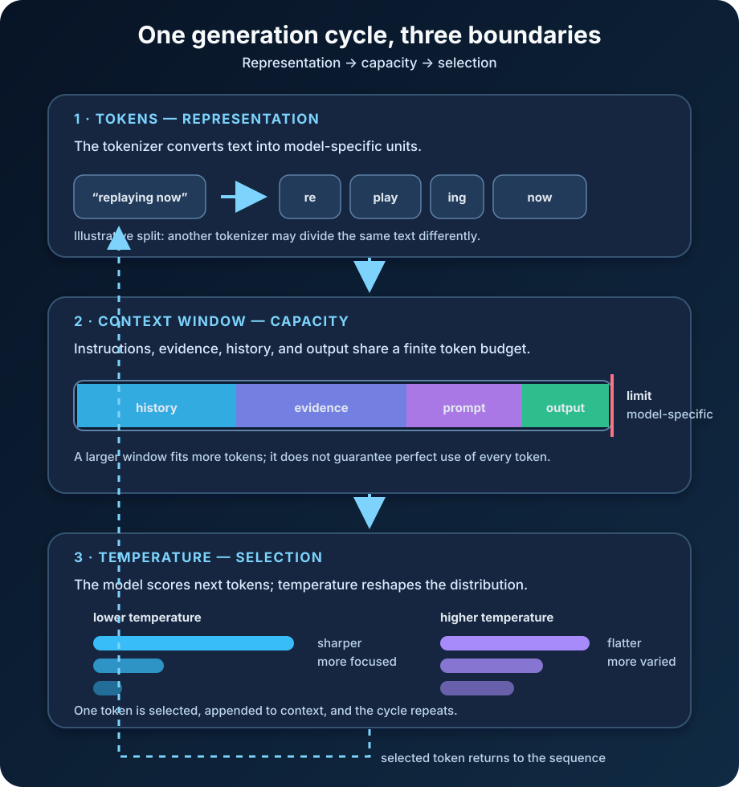

You paste a long report into an AI assistant, ask for a precise summary, and receive an answer that sounds confident but overlooks the one paragraph that mattered.

So you try three fixes. You count the words. You choose a model with a larger context window. You lower the temperature.

All three actions sound relevant, but they change different parts of the system. Word count is not token count. A bigger context window increases capacity, not guaranteed attention. Lower temperature narrows the model's choices, but it does not make missing evidence appear.

This confusion disappears once the three ideas have separate jobs:

- **Tokens are the units the model processes.**
- **The context window is the token budget available to one generation request.**
- **Temperature reshapes the probabilities used to choose each next token.**

They meet in one loop, but they are not interchangeable controls.



## Tokens are not words

A language model does not receive a paragraph as an indivisible piece of meaning. A tokenizer converts the text into a sequence of token IDs first. Those tokens may represent a whole common word, part of a word, punctuation, whitespace, a byte sequence, or another recurring text fragment.

The [Google Machine Learning Crash Course](https://developers.google.com/machine-learning/crash-course/llm) calls tokens the atomic units of language modeling and notes that modern language models commonly use subwords. A word such as `unwatched`, for example, can be divided into pieces resembling `un`, `watch`, and `ed`. That does not mean every model will divide it in exactly that way.

Token boundaries depend on the model's tokenizer and vocabulary. Capitalization, spaces, source code, numbers, emoji, and language can all change the split. Two strings with the same number of visible characters may therefore consume different numbers of tokens. Two models may also tokenize the same string differently.

Subword tokenization is a compromise. A vocabulary containing every possible word would become enormous and would still struggle with new names, misspellings, and word forms. A character-only vocabulary would handle unknown text but create much longer sequences. Systems such as SentencePiece learn reusable pieces between those extremes; its [original ACL paper](https://aclanthology.org/D18-2012/) describes a language-independent tokenizer that can learn subword units directly from raw sentences.

Once tokenized, each token ID is mapped to a numerical representation the network can process. During generation, the direction reverses: the model selects another token ID, the tokenizer decodes generated IDs back into text, and the interface displays the result.

This is why “How many words fit?” has no universal answer. Rules of thumb can help with rough planning, but production software should use the tokenizer for the exact model. The [OpenAI API key concepts guide](https://developers.openai.com/api/docs/concepts) makes the same distinction and provides only an English-language approximation, not a conversion law.

Token counts have practical consequences. They affect whether a request fits, how much text can be generated, and often the cost and latency of an API call. A compact prompt is useful not because short prompts are morally better, but because irrelevant tokens compete for a limited budget and make the real task harder to see.

## The context window is working space, not memory

The **context window** is the maximum number of tokens a model can use during a generation request. Depending on the model and API, that total can include instructions, conversation history, retrieved documents, tool definitions and results, the current user message, generated output, and sometimes reasoning tokens.

Suppose an application has a context budget of 16,000 tokens. It sends 9,000 tokens of conversation history, 4,000 tokens of retrieved documentation, and 1,000 tokens of current instructions. Only 2,000 tokens remain within that simplified budget for the answer. The application may need to reject the request, trim old material, summarize it, retrieve a smaller set of documents, or reserve fewer output tokens.

The precise accounting rules are provider- and model-specific. [OpenAI's conversation-state documentation](https://developers.openai.com/api/docs/guides/conversation-state) defines a context window as the maximum tokens available to one request and explains that input, output, and reasoning tokens can all count toward it for applicable models. Model documentation, not an old comparison chart, is the right place to check a current limit.

A context window is also not the model's permanent memory. If an earlier fact is absent from the current request, the model cannot recover it merely because it appeared in a chat last month. The surrounding application must store that state and send it again, retrieve it when relevant, or compact older history into a smaller representation.

Nor is the context window the same as training knowledge. Training shaped the model's parameters before the request arrived. Context is temporary evidence supplied for this particular generation. Adding a document can help the model answer from that document without retraining its parameters.

### More capacity does not guarantee perfect use

A larger window lets an application *present* more material. It does not prove the model will identify every relevant detail inside it.

The peer-reviewed study [“Lost in the Middle”](https://aclanthology.org/2024.tacl-1.9/) tested multi-document question answering and key-value retrieval. The researchers found that performance could change significantly with the position of relevant information and often declined when that information appeared in the middle of a long context.

The practical lesson is not to avoid long context. It is to treat capacity and retrieval quality as separate concerns. Remove irrelevant material, give documents clear boundaries, identify source metadata, put the task close to the evidence it depends on, and evaluate the real workload. If only three paragraphs answer the question, retrieving those paragraphs is usually better than pasting three hundred pages and hoping scale becomes attention.

## Temperature changes selection, not knowledge

After processing the current context, an autoregressive language model produces a score for each possible next token. A softmax operation turns those scores into a probability distribution. The decoder then chooses a token, appends it to the sequence, and repeats.

**Temperature changes the shape of that distribution before sampling.** In the common formulation, the model's scores, or logits, are divided by the temperature before softmax:

```text
probability(token) = softmax(logit(token) / temperature)
```

With a temperature below 1, differences between scores become more pronounced. High-probability tokens take more of the probability mass, so selection is usually more focused. With a temperature above 1, the distribution becomes flatter, giving lower-ranked tokens more opportunity to be sampled. At 1, the original scale is preserved.

Exact ranges and the behavior of special values such as zero vary by implementation. Some APIs interpret zero as greedy or near-deterministic decoding; others require a positive value or apply additional controls. The current model and API documentation should decide what a setting means.

The important boundary is universal: temperature operates during decoding. It does not retrain the model, enlarge the context window, add facts, verify claims, or measure confidence. A low-temperature answer can be consistently wrong. A high-temperature answer can be imaginative and correct. Factual reliability still depends on the model, instructions, evidence, tools, and verification process.

[Hugging Face's generation documentation](https://huggingface.co/docs/transformers/main/en/generation_strategies) separates greedy decoding from multinomial sampling, while its [generation configuration reference](https://huggingface.co/docs/transformers/main/en/main_classes/text_generation) exposes temperature as a control over next-token probabilities. [Google Cloud's generation-parameter reference](https://docs.cloud.google.com/gemini-enterprise-agent-platform/models/capabilities/content-generation-parameters) similarly describes temperature, top-p, and top-k as controls over token sampling.

## Temperature, top-p, and top-k solve related problems

Temperature is often discussed beside two filters:

- **Top-k** keeps only the *k* highest-probability token candidates before selection.
- **Top-p**, or nucleus sampling, keeps the smallest set of candidates whose cumulative probability reaches a threshold.

Temperature reshapes the distribution; top-k and top-p restrict the candidate set. Implementations may combine them in a defined order, and defaults differ. Changing several controls at once makes results harder to interpret, so begin with the provider's defaults and tune one dimension against a representative evaluation set.

There is no universally correct “creative temperature” or “factual temperature.” A model version, prompt, language, task, and decoding implementation can all change the result. For extraction, classification, or structured output, a more focused configuration may improve repeatability. For brainstorming, several sampled candidates may create useful variety. Neither choice removes the need to test.

## Keep the three boundaries straight

| Concept | What it controls | What it does not control | Practical question |
| --- | --- | --- | --- |
| Tokens | How text is represented and counted | The model's truthfulness | How many model-specific units does this request consume? |
| Context window | How much tokenized material fits in one request | Guaranteed recall or permanent memory | Which instructions, evidence, history, and output must share the budget? |
| Temperature | How next-token probabilities are reshaped for sampling | Knowledge, training, or context capacity | How much variation is useful for this task? |

This table also suggests a troubleshooting order.

If the request is rejected or the answer is cut short, inspect token accounting and output reservations. If a detail is ignored, confirm that it actually reached the request, reduce noise, improve retrieval, and test its placement. If repeated runs are too variable or too repetitive, inspect the decoding strategy and temperature. Do not use a temperature change to solve a missing-context problem.

## Common mistakes that sound reasonable

The first mistake is estimating every language with an English words-to-tokens shortcut. Token density varies with the tokenizer and text. Count with the real tokenizer when limits or cost matter.

The second is filling a large context window simply because it exists. Extra material can increase cost and bury relevant evidence. Context should be curated, not merely occupied.

The third is treating chat history as durable memory. Interfaces may store, summarize, truncate, or selectively resend earlier turns. If an application must remember a customer preference or policy decision, keep that fact in an explicit state system and retrieve it deliberately.

The fourth is calling temperature a creativity or accuracy dial without qualification. It changes sampling probabilities. The human qualities we observe are downstream effects, not guarantees attached to the number.

Finally, teams sometimes tune on one pleasing example. Generation is probabilistic, so evaluate a set of realistic prompts across multiple runs. Measure task success, factual support, format compliance, latency, and token use. A setting is useful only when it behaves well for the system you are actually building.

## The concise takeaway

Tokens, context windows, and temperature describe three stages of the same generation process. The tokenizer turns text into processable units. The context window limits how many of those units can participate in one request. Temperature influences how the decoder chooses the next unit from the model's probability distribution.

Remember them as **representation, capacity, and selection**.

That mental model prevents three expensive category errors: counting words when the system counts tokens, buying a larger window when the real problem is retrieval, and lowering temperature when the model simply lacks trustworthy evidence.

## Continue learning

- [What Is a Large Language Model and How Does It Work?](/posts/what-is-a-large-language-model/)
- [What Is Generative AI and How Does It Work?](/posts/what-is-generative-ai/)
- [AI Training vs AI Inference](/posts/ai-training-vs-ai-inference/)
- [Model Context Protocol Explained](/posts/model-context-protocol-explained-llms-real-world-data/)

## Sources

- [Google Machine Learning Crash Course: Introduction to Large Language Models](https://developers.google.com/machine-learning/crash-course/llm)
- [OpenAI API: Key Concepts — Tokens](https://developers.openai.com/api/docs/concepts)
- [OpenAI API: Managing the Context Window](https://developers.openai.com/api/docs/guides/conversation-state)
- [Hugging Face Transformers: Generation Strategies](https://huggingface.co/docs/transformers/main/en/generation_strategies)
- [Hugging Face Transformers: Generation Configuration](https://huggingface.co/docs/transformers/main/en/main_classes/text_generation)
- [Google Cloud: Content Generation Parameters](https://docs.cloud.google.com/gemini-enterprise-agent-platform/models/capabilities/content-generation-parameters)
- [ACL: SentencePiece — A Simple and Language Independent Subword Tokenizer and Detokenizer](https://aclanthology.org/D18-2012/)
- [TACL: Lost in the Middle — How Language Models Use Long Contexts](https://aclanthology.org/2024.tacl-1.9/)
