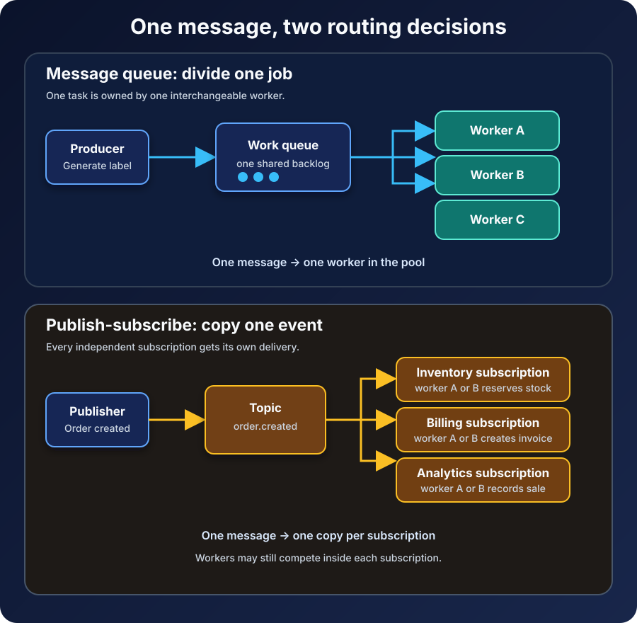

An order is placed. Inventory must reserve stock, billing must create an invoice, analytics must record the sale, and an email must reach the customer.

It is tempting to put that order into one queue and start four consumers. The diagram looks asynchronous and scalable. The behavior, however, is wrong: if those consumers compete for messages, one may reserve stock while another sends the email, but no single order triggers all four actions.

That mistake reveals the practical difference between a **message queue and publish-subscribe**:

- A message queue usually distributes each unit of work to one consumer in a worker group.
- Publish-subscribe distributes each publication to every interested subscription.

Both patterns decouple senders from receivers. Both can use a broker, acknowledgments, retries, and durable storage. The decisive question is not whether the system is asynchronous. It is **how many independent outcomes one message must create**.



## The shortest useful answer

Use a **message queue** when a message represents work that should be completed once by one member of a cooperating worker pool. Resize an image, generate an invoice PDF, or reconcile one payment. Adding workers increases capacity; it does not create new business outcomes.

Use **publish-subscribe**, often shortened to pub/sub, when a message represents information that several independent consumers may need. An `order.created` event can be relevant to inventory, billing, analytics, and notifications. Each subscriber owns a different reaction, and one subscriber's success does not replace another's.

| Question | Message queue | Publish-subscribe |
| --- | --- | --- |
| Who receives a message? | One consumer from a competing group | One consumer for each interested subscription |
| Typical intent | "Please do this work" | "This event happened" |
| Scaling model | Add workers to share one backlog | Add subscriptions for new outcomes; add workers within each subscription for capacity |
| Failure scope | The work remains incomplete until a worker succeeds or it is dead-lettered | Each subscription succeeds, retries, and falls behind independently |
| Common example | Generate one thumbnail | Notify search, analytics, and email that a video was uploaded |

The word *usually* matters. Messaging products expose different abstractions, and a queue can sit behind a subscription. Product names do not define the architecture. Routing and ownership do.

## A queue is a work assignment

Imagine that a store must generate a shipping label for every packed order. The application writes a `GenerateLabel` command to a durable queue. Three worker instances read from that queue.

Those workers are interchangeable. They perform the same responsibility, so they **compete** for each message. If worker A receives order 842, workers B and C should not also print labels for order 842. They move on to other messages.

This is the [Competing Consumers pattern](https://learn.microsoft.com/en-us/azure/architecture/patterns/competing-consumers). The queue becomes both a handoff point and a buffer. When orders arrive faster than labels can be generated, the backlog grows instead of forcing checkout to wait. When capacity is needed, the operator can add more label workers.

An acknowledgment normally tells the broker that processing finished and the message can be removed. If a worker fails before acknowledging, the broker can make the message available again. RabbitMQ's [work queue tutorial](https://www.rabbitmq.com/tutorials/tutorial-two-python) demonstrates both round-robin distribution and redelivery after an unacknowledged delivery.

That recovery behavior creates an important consequence: a handler may see the same message more than once. Printing a second label, charging a card twice, or applying the same account credit twice is not acceptable merely because the broker retried correctly. Consumers should make their effects idempotent, often by recording a stable message or operation ID alongside the result.

The queue is therefore not a magic "exactly once" machine. It is a boundary where ownership, retries, deduplication, and failure policy become explicit.

## Pub/sub is an announcement

Now change the message from `GenerateLabel` to `OrderCreated`.

This is not an instruction for one interchangeable worker. It is a fact that several parts of the business interpret differently. Inventory reserves stock. Billing prepares an invoice. Analytics updates sales data. Notifications sends a receipt.

In the [Publisher-Subscriber pattern](https://learn.microsoft.com/en-us/azure/architecture/patterns/publisher-subscriber), the ordering service publishes once without knowing every receiver. The broker routes a copy to an output channel or subscription for each interested consumer. A new fraud-analysis subscriber can be added later without teaching the ordering service its endpoint.

The independence is deeper than fan-out. Each subscription has its own progress and failure state. If analytics is offline, inventory can still process the event. Analytics builds a backlog and catches up according to its own retention and retry policy.

Google Cloud's [Pub/Sub overview](https://docs.cloud.google.com/pubsub/docs/pubsub-basics) makes the composition especially clear: each topic subscription receives a copy, while multiple subscriber instances attached to that *same subscription* divide its messages among themselves. In other words, pub/sub and queues are not mutually exclusive building blocks.

```text
order.created topic
|-- inventory subscription -> inventory worker A or B
|-- billing subscription   -> billing worker A or B
`-- analytics subscription -> analytics worker A or B
```

The event fans out across subscriptions. Within each subscription, workers compete. This is the pattern behind many production systems that must create several outcomes and scale each outcome independently.

## Commands and events make the choice easier

A useful design test is to read the message aloud.

A **command** asks for a specific action: `GenerateInvoice`, `ResizeImage`, or `RebuildSearchIndex`. It has one logical owner, even if many identical worker instances can handle it. A queue is often the natural fit.

An **event** states something that already happened: `InvoiceIssued`, `ImageUploaded`, or `ProductPriceChanged`. It does not tell consumers what they must do. Zero, one, or many subscribers may react. Pub/sub is often the natural fit.

The distinction is about intent, not grammar. Naming a command `InvoiceGenerationRequestedEvent` does not turn it into a fact. Likewise, an event can still be delivered through a queue. Ask who owns the outcome and whether every interested consumer needs its own chance to process the message.

There is also a lifecycle difference. A command sender generally needs confidence that an owner exists. Publishing a command into a channel with no consumer can leave required work stranded. An event publisher may legitimately have no subscribers today; the fact still describes what occurred. Whether late subscribers can replay old events depends on the broker's retention and subscription model, not on the phrase *pub/sub* alone.

## Delivery guarantees do not choose the pattern for you

Teams sometimes compare queues and pub/sub as if one were durable and the other were fire-and-forget. That is not a safe assumption.

RabbitMQ can bind durable queues to an exchange, while its tutorial also shows temporary subscriptions where messages published before a queue is bound are intentionally missed. Cloud pub/sub services can retain unacknowledged messages and redeliver them. AWS documents a common [fan-out design using an SNS topic and multiple SQS queues](https://docs.aws.amazon.com/sns/latest/dg/sns-sqs-as-subscriber.html), combining pub/sub routing with durable queue behavior for each consumer.

For either pattern, define these properties instead of inferring them from a product label:

- What event confirms that the broker accepted the message?
- Is delivery at most once, at least once, or subject to a narrower exactly-once feature?
- How long are unprocessed messages retained?
- What causes redelivery, and when does a message move to a dead-letter destination?
- What ordering scope exists: global, per partition, per key, per session, or none?
- Can a new subscription receive messages published before it existed?

Ordering deserves special care. Multiple workers improve throughput precisely because work can proceed concurrently. Global ordering fights that concurrency. Many systems offer ordering only within a key, partition, or session; handlers should not assume that creation order is delivery order.

## The failure you monitor is different

With one work queue, the central operational question is whether the worker pool is keeping up. Useful signals include queue depth, age of the oldest message, processing latency, redelivery count, poison messages, and dead-letter volume.

With pub/sub, there is no single "consumer is healthy" answer. Inventory may be current while analytics is three hours behind. Monitor backlog age and failures **per subscription**. A topic can accept publications perfectly while one business outcome silently stops happening.

Schema changes also become more delicate as subscribers multiply. A producer and four independently deployed consumers will not upgrade atomically. Prefer backward-compatible additions, keep a stable event meaning, and allow subscribers to ignore fields they do not recognize. If a change alters the meaning rather than merely extending the data, publish a new event type or deliberately version the contract.

Observability must cross the broker boundary too. Include a stable message ID, event type, occurrence time, schema version, and correlation or trace identifier. Do not put secrets in routing keys or casually place sensitive personal data in a widely subscribed event.

## Common mistakes that look reasonable at first

The first mistake is attaching unlike consumers to one queue. If billing and email read from the same queue, they compete; each order triggers one of those outcomes, not both.

The second is creating several application instances and mistaking them for several subscriptions. Instances on one subscription usually share its work. Create a separate subscription when a separate business capability needs every relevant event.

The third is broadcasting commands. If three subscribers all interpret `ChargeCard` as their instruction, duplication is part of the design. Route a command to one logical owner; publish the resulting `PaymentCaptured` event for other capabilities.

The fourth is acknowledging too early. An acknowledgment before the durable side effect turns a worker crash into lost work. Acknowledging after the effect can cause a duplicate when the effect succeeds but the acknowledgment is lost. Idempotency closes that gap more reliably than optimistic timing.

The fifth is treating the broker as infinite storage. Queues and subscriptions absorb temporary differences in speed, not permanent under-capacity. Backlog growth needs limits, alerts, capacity planning, and a policy for messages that can never succeed.

## A practical selection checklist

Start with the outcome, then choose the routing shape:

1. If exactly one logical handler should own the work, begin with a queue and competing consumers.
2. If several independent capabilities need the same fact, begin with a topic and one subscription per capability.
3. If each capability also needs horizontal scale, place a worker pool behind each subscription.
4. If the sender needs an immediate answer, asynchronous messaging may be the wrong boundary; consider request-response instead.
5. If losing, duplicating, delaying, or reordering a message matters, specify the behavior and test the failure path before production.

The durable mental model is simple: **queues divide work; pub/sub multiplies audiences**. Real systems often do both. A topic fans an event out to independent subscriptions, and each subscription behaves like a queue whose workers share the load.

Choose according to ownership, not fashion. Then make acknowledgments, retries, retention, ordering, idempotency, and monitoring explicit. The arrows in the architecture diagram are the easy part; the promises behind them are the system.

## Continue learning

- [Message Queues Explained: How Asynchronous Systems Work](/posts/message-queues-explained/)
- [What Is Serverless Computing and How Does It Work?](/posts/what-is-serverless-computing/)
- [Monolithic Architecture vs Microservices](/posts/monolithic-architecture-vs-microservices/)
- [What Is a REST API and How Does It Work?](/posts/what-is-a-rest-api/)

## Sources

- [Microsoft Azure Architecture Center: Competing Consumers pattern](https://learn.microsoft.com/en-us/azure/architecture/patterns/competing-consumers)
- [Microsoft Azure Architecture Center: Publisher-Subscriber pattern](https://learn.microsoft.com/en-us/azure/architecture/patterns/publisher-subscriber)
- [Google Cloud: Overview of the Pub/Sub service](https://docs.cloud.google.com/pubsub/docs/pubsub-basics)
- [RabbitMQ tutorial: Work Queues](https://www.rabbitmq.com/tutorials/tutorial-two-python)
- [RabbitMQ tutorial: Publish/Subscribe](https://www.rabbitmq.com/tutorials/tutorial-three-python)
- [AWS: Fanout to Amazon SQS queues](https://docs.aws.amazon.com/sns/latest/dg/sns-sqs-as-subscriber.html)
