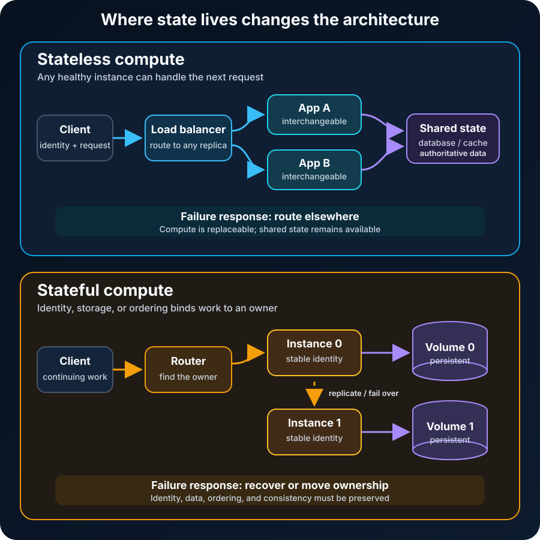

A user adds three items to a shopping cart. The next request reaches a different server, and the cart is suddenly empty.

Nothing is wrong with the load balancer. The application quietly assumed that the same user would always return to the same process. Scaling exposed a decision the code had already made: important state lived inside one replaceable server.

This is the practical difference between stateless and stateful applications. A **stateless application instance can handle the next request without relying on information kept only by that instance from earlier interactions**. A **stateful application instance retains information that later work depends on**, often with an identity, storage location, or execution order that must survive beyond one request.

Neither model means “has data” versus “has no data.” Almost every useful system has state somewhere. The real question is **where the authoritative state lives, who owns it, and what must happen when the process holding it disappears**.

## State is what the next operation needs from the past

State is information that must outlive the operation that created it. It can include:

- a customer's cart and account balance;
- an authenticated session and its expiration time;
- the current turn in a multiplayer game;
- a message consumer's processing position;
- a database record, file, or workflow status.

Not all state has the same importance. A cached product image can be recreated. A confirmed payment cannot. An in-progress upload may live for minutes, while an invoice must remain durable for years. Before choosing an architecture, classify the state by lifetime, authority, consistency, recoverability, and ownership.

The [CNCF Cloud Native Glossary](https://glossary.cncf.io/stateless-apps/) describes a stateless application as handling each request independently instead of remembering previous interactions. That definition is useful, but it applies to a boundary. A stateless API process can still read orders from PostgreSQL, write files to object storage, and update a distributed cache. The process is stateless because another equivalent process can continue the work using the request and shared services.

## Stateless does not mean storage-free

Imagine an online store with four identical API instances behind a load balancer. A request contains an authenticated user identity and an order ID. Whichever instance receives it reads the order from a shared database, applies the business rule, saves the new state, and returns a response.

The order is stateful. The API instance is not its permanent home.

This separation makes the compute instances interchangeable. If one crashes, the load balancer can send the next request elsewhere. If traffic increases, more instances can be added without copying private session memory into each one. During a rolling deployment, old and new instances can overlap while the durable state remains in services with their own migration and compatibility rules.

This is why statelessness is strongly associated with horizontal scaling, but it is not free. Moving state out of the process introduces network calls, serialization, storage cost, and a dependency whose latency and availability now affect the request. The shared store can also become the bottleneck that adding application instances cannot solve.

Microsoft's [scaling and partitioning guidance](https://learn.microsoft.com/en-us/azure/well-architected/performance-efficiency/scale-partition) recommends externalizing server-side session state when possible, while explicitly asking teams to consider size, access frequency, timeouts, latency, consistency, and scalability. “Put it in a database” is not a complete design. You still need the right state store and failure policy.

## Stateful instances make identity matter

A stateful service keeps information locally or binds a particular instance to persistent resources. Databases, distributed logs, game servers, and stream processors are common examples.

Suppose a partition of an event stream is assigned to worker 3. That worker owns an ordered sequence, an offset, and perhaps a local materialized view. Sending the next event to any random replica may break ordering or force an expensive transfer. The platform needs to know which instance owns the partition, where its data lives, and how ownership moves after failure.

Stateful designs can provide valuable data locality. Keeping computation near its state may avoid a remote read on every operation. It can also make an ownership model clearer: one leader coordinates writes for a partition while followers replicate its log. The bill arrives in replication, failover, backup, rebalancing, recovery time, and consistency rules.

Kubernetes makes the operational distinction visible. Its [workload documentation](https://kubernetes.io/docs/concepts/workloads/) describes Deployment replicas as interchangeable and suited to stateless workloads. A StatefulSet, by contrast, can associate a workload with persistent storage. The [StatefulSet documentation](https://kubernetes.io/docs/concepts/workloads/controllers/statefulset/) adds stable identities and ordered lifecycle behavior for workloads that need them.

A StatefulSet does not make an application reliably stateful by itself. It can preserve an identity and reconnect storage, but the application or data system still needs correct replication, consistency, backup, restore, and failure-handling behavior. Stable storage is not automatically replicated storage, and replicated storage is not automatically a tested backup.

## HTTP is stateless; web applications often are not

This vocabulary becomes confusing because the protocol and the application can make different choices.

[RFC 9110](https://www.rfc-editor.org/rfc/rfc9110.html) defines HTTP as stateless: each request's meaning can be understood in isolation, without relying on which connection carried a previous request. That property helps proxies reuse connections and load balancers route requests dynamically.

Yet web applications routinely support signed-in users, saved carts, preferences, and multi-step workflows. Cookies are one bridge. [RFC 6265](https://www.rfc-editor.org/rfc/rfc6265.html) defines how a server sends cookie state to a user agent and how the user agent returns it on later requests.

The cookie might contain the state itself, but more commonly it contains an opaque session identifier. The server uses that identifier to find session data in a shared store. The HTTP request is still self-identifying enough to route to any application instance, while the overall application maintains state across requests.

This leads to an important correction: **a stateless service can participate in a stateful user experience**. Statelessness is about the service boundary and ownership model, not the absence of continuity.

## Sticky sessions are a bridge, not a cure

When session data lives in one server's memory, a load balancer can use session affinity—often called a sticky session—to route that user back to the same server. This may be a practical migration step for an existing application, and it can reduce repeated state lookups.

It also preserves the underlying dependency. If that server fails, the session may disappear. Uneven users can produce uneven load. Scaling down becomes harder because active sessions must drain, expire, or move. Deployments need to account for old in-memory state.

As the [Azure scale-out guidance](https://learn.microsoft.com/en-us/azure/architecture/guide/design-principles/scale-out) explains, instance stickiness limits the freedom to distribute requests. Use affinity when the state genuinely benefits from locality or while deliberately managing a transition—not merely because it hides an accidental architecture.

## The tradeoff is about movement and ownership

| Design question | Stateless compute | Stateful compute |
| --- | --- | --- |
| Can any healthy instance handle the next request? | Usually yes | Often no; identity or ownership may matter |
| Where does authoritative state live? | In the request, client, or shared external service | With an instance, partition, volume, or replicated group |
| What happens when an instance fails? | Retry or route elsewhere, if the operation is safe | Recover, reattach, replay, replicate, or elect a new owner |
| How does horizontal scaling work? | Add interchangeable instances | Partition state and rebalance ownership |
| Main operational risk | External-store bottlenecks and hidden retry semantics | Data loss, split ownership, slow recovery, and consistency errors |

Statelessness usually makes compute easier to move. Statefulness can make data easier to use efficiently. Architecture decides which kind of movement is more expensive.

## Stateless requests still need safe retries

Replaceable servers do not guarantee harmless repetition. A client can time out after the server charges a card but before the response arrives. Retrying the same request through another instance may charge it twice unless the operation has an idempotency strategy.

A robust design can attach a unique operation key to the request, store the outcome durably, and return that outcome when the same operation is submitted again. This is state used to make retries safe. The compute remains interchangeable precisely because the deduplication record is not trapped inside one process.

The same principle applies to asynchronous systems. A worker can be stateless between deliveries while a queue tracks delivery and the application stores processed message IDs. The system remains stateful; the worker's replaceability is an architectural choice.

## Most systems should separate the two concerns

The useful design is rarely “make everything stateless” or “keep everything local.” It is usually a composition:

1. Keep request handling and business logic replaceable where practical.
2. Put authoritative data in a system designed for persistence and concurrency.
3. Keep reconstructable data, such as caches, explicitly disposable.
4. Use stateful workers when ordering, locality, or latency justifies stable ownership.
5. Design the handoff between compute and state for timeouts, retries, version changes, and partial failure.

A storefront can use stateless web and API tiers, a stateful relational database for orders, a cache for replaceable data, and stateful stream processors for real-time inventory projections. Calling the entire application stateless would hide the most important operational work. Calling it stateful would hide the replaceability of its compute tier.

[Software architecture](/posts/software-architecture-beginners-guide/) becomes clearer when each boundary says what state it owns. [Load balancing](/posts/what-is-load-balancing/) becomes safer when any-server routing is an explicit guarantee. [Serverless computing](/posts/what-is-serverless-computing/) becomes less surprising when temporary execution environments are not mistaken for durable storage. And [cloud regions and availability zones](/posts/cloud-regions-vs-availability-zones/) matter because the state layer determines what can actually survive a failure boundary.

## Questions to ask before choosing

- What information must survive this request, process, host, zone, or region?
- Which copy is authoritative, and which copies can be rebuilt?
- Can the next request go to any instance without changing its meaning?
- If an operation is retried, can it safely run twice?
- Does the workload require ordering, stable identity, or data locality?
- How will state be partitioned, replicated, backed up, restored, and migrated?
- What recovery time and data-loss window are acceptable?
- Are sticky sessions solving a real locality problem or hiding local memory?

## The takeaway

Stateless and stateful are not labels for whether software uses data. They describe a dependency across time.

Stateless compute makes instances easier to replace, route, scale, and deploy because the next operation does not depend on private history inside one instance. Stateful compute keeps identity and data close because later work depends on what that instance or partition already knows.

Good systems make that dependency visible. They keep replaceable things replaceable, protect authoritative state with mechanisms designed for it, and treat the boundary between the two as part of the architecture—not as an implementation detail to discover during an outage.

## Continue learning

- [What Is Load Balancing and How Does It Work?](/posts/what-is-load-balancing/)
- [What Is Serverless Computing and How Does It Work?](/posts/what-is-serverless-computing/)
- [Cloud Regions vs Availability Zones](/posts/cloud-regions-vs-availability-zones/)
- [What Is Software Architecture? A Beginner's Guide](/posts/software-architecture-beginners-guide/)

## Sources

- [RFC 9110: HTTP Semantics](https://www.rfc-editor.org/rfc/rfc9110.html)
- [RFC 6265: HTTP State Management Mechanism](https://www.rfc-editor.org/rfc/rfc6265.html)
- [CNCF Cloud Native Glossary: Stateless Apps](https://glossary.cncf.io/stateless-apps/)
- [Kubernetes documentation: Workloads](https://kubernetes.io/docs/concepts/workloads/)
- [Kubernetes documentation: StatefulSets](https://kubernetes.io/docs/concepts/workloads/controllers/statefulset/)
- [Microsoft Azure Well-Architected Framework: Scale and Partition](https://learn.microsoft.com/en-us/azure/well-architected/performance-efficiency/scale-partition)
- [Microsoft Azure Architecture Center: Design to Scale Out](https://learn.microsoft.com/en-us/azure/architecture/guide/design-principles/scale-out)
