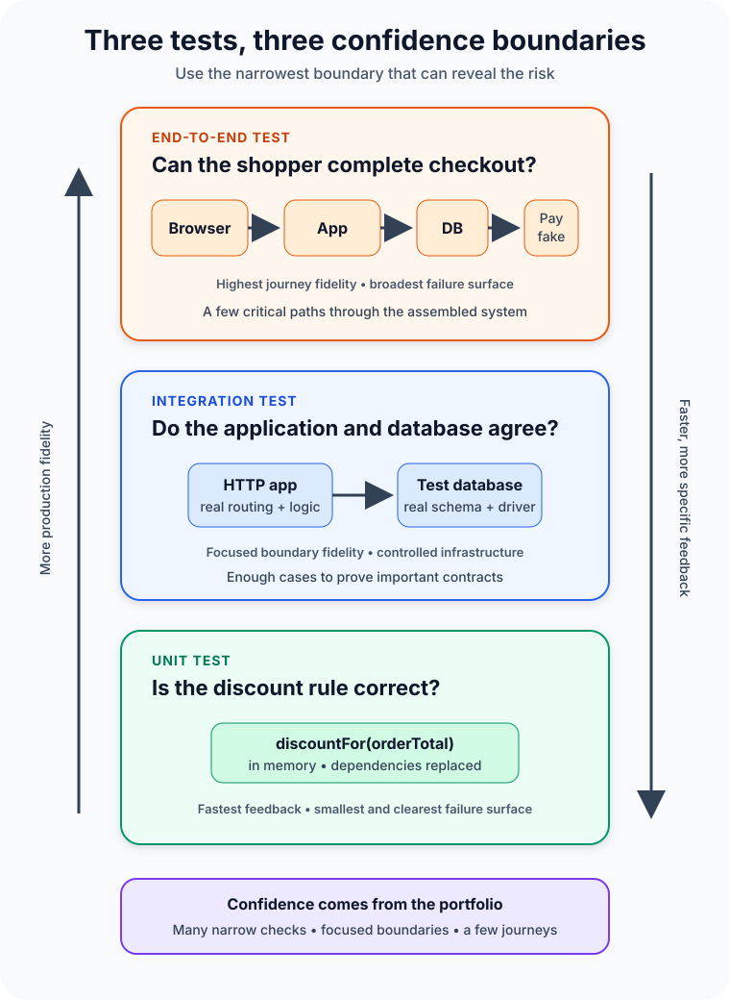

A customer applies a discount, pays for an order, and sees a confirmation page. The feature works on a developer's laptop. Then the production release fails because the discount rounds differently in one case, the database rejects a field, or the checkout button waits for an element that never appears.

All three failures belong to the same feature. They do not belong to the same test.

That distinction is the heart of **unit testing vs integration testing vs end-to-end testing**. These test types are not competing ways to prove that software works. Each looks at a different boundary and answers a different question:

- **Unit test:** Does one small piece of logic behave correctly in isolation?
- **Integration test:** Do selected components or infrastructure boundaries work together?
- **End-to-end test:** Can a user complete a valuable journey through the assembled system?

A healthy test strategy combines all three. The goal is not maximum test count. It is fast, useful evidence at the narrowest level that can reveal the failure.



## The boundary matters more than the label

Testing vocabulary is less universal than it sounds. One team may call an HTTP test against an in-memory application an integration test. Another may reserve that label for tests using a real database. A third may call any browser-driven test end to end even when the backend is mocked.

Instead of arguing over names, write down what each suite includes.

For our checkout example, a useful agreement might be:

- Unit tests run one class or function in memory and replace database, network, clock, and payment dependencies.
- Integration tests start the application with a real test database and exercise it through HTTP, while the external payment provider remains fake.
- End-to-end tests drive a real browser through the deployed application and its controlled supporting services.

Now a failing suite tells the team something specific. The boundary—not the folder name—defines the test.

| Test type | Best question | Typical boundary | Main tradeoff |
| --- | --- | --- | --- |
| Unit | Is this rule correct? | One function, class, or module | Fast and precise, but cannot prove integrations |
| Integration | Do these parts agree? | App plus database, filesystem, queue, or service contract | Higher confidence at a higher setup cost |
| End to end | Does the critical journey work? | User interface through the assembled system | Realistic, but slower and harder to diagnose |

## Unit tests protect decisions

Suppose the store gives a 10 percent discount to orders of at least €100. A unit test can call the pricing function with values just below, at, and above the threshold.

```typescript
// Abbreviated example: test the business rule without infrastructure.
describe("discountFor", () => {
  it("applies ten percent at the threshold", () => {
    expect(discountFor(100)).toBe(10);
  });

  it("does not apply below the threshold", () => {
    expect(discountFor(99)).toBe(0);
  });
});
```

The database is irrelevant to this question. So are the browser, payment gateway, and network. Leaving them out makes the test fast, deterministic, and easy to debug. If the assertion fails, the search area is tiny.

Microsoft's testing guidance describes unit tests as exercising an individual component or unit of work without infrastructure such as databases, filesystems, or network resources. That isolation is valuable because developers can run many cases while editing code, including awkward edge cases that would be tedious to reach through a user interface.

Isolation does not mean testing every private method or mocking every collaborator. A useful unit can be a pure function, a class, or a cohesive module accessed through its public behavior. Tests coupled to internal call order often break during harmless refactoring even though the result remains correct.

Use unit tests for calculations, validation, state transitions, parsing, permissions, and other branching logic. They are especially good at exploring many inputs cheaply. They cannot tell you whether a database column has the wrong type or whether two services disagree about a JSON field.

## Integration tests protect agreements

The checkout service eventually has to save the discounted total. The code may calculate €10 correctly and still fail because the application sends a decimal in a format the database driver, schema, or serializer does not accept.

That is an integration problem.

An integration test crosses a meaningful boundary. It might verify that:

- an HTTP request passes through routing, validation, business logic, and persistence;
- an object can be written to and read from the actual database engine;
- a producer's event matches the consumer's expected schema;
- an adapter handles a dependency's documented success and error responses.

Microsoft Learn defines integration tests as exercising two or more components together and notes that they often include infrastructure concerns. Its ASP.NET Core guidance uses a test host and client to process requests while allowing test-specific configuration, such as a separate database.

The word *real* needs care here. A SQLite in-memory database is convenient, but it cannot reveal every PostgreSQL-specific behavior. A mocked HTTP client can verify how your code reacts, but it cannot prove that the provider's live contract still matches the mock. Choose the dependency that must be real based on the risk you are testing.

Integration tests are slower because setup, I/O, migrations, and cleanup cost time. They are also harder to isolate. Control test data, create a known starting state, and clean up without relying on test execution order. A shared mutable environment turns useful failures into mysteries.

## End-to-end tests protect journeys

The final question is larger: can a shopper open the site, add a product, apply the discount, pay, and see a confirmation?

An end-to-end test approaches the system from an external entry point and follows a complete workflow. In a web application, that often means a real browser interacting with user-visible controls while the request travels through the frontend, backend, and data layer.

This test can expose failures that narrower tests miss: a broken deployment configuration, incompatible frontend and backend releases, missing assets, an authentication redirect loop, or a button hidden behind an unexpected dialog.

That realism has a cost. Google Testing Blog describes end-to-end tests as slower, more prone to flakiness, and more expensive to maintain than unit or integration tests. When one fails, the defect could be anywhere along a long chain—or the application could be fine while the test data, browser timing, network, or environment is not.

Keep end-to-end coverage focused on critical user journeys rather than reproducing every validation branch through the browser. One checkout success path and a small number of high-value failure paths can prove that the system is connected. Unit tests can cover the discount permutations; integration tests can cover persistence and API contracts.

Playwright's official guidance adds two practical rules for browser tests: verify user-visible behavior instead of implementation details, and keep tests isolated with their own state. A locator tied to an accessible role and name usually survives a CSS refactor better than a selector tied to a generated class.

## Why three green suites still do not prove correctness

Automated functional tests reduce uncertainty; they do not erase it.

A unit test can faithfully verify the wrong requirement. An integration environment can differ from production. An end-to-end test can cover the happy path while missing an accessibility problem, race condition, or destructive retry. Code coverage reports which code ran, not whether the assertions were meaningful.

Other risks require other evidence: performance tests for latency and capacity, security tests for attack paths, resilience tests for dependency failure, accessibility checks, exploratory testing, and production monitoring. Unit, integration, and end-to-end tests are three important lenses, not the whole quality system.

## Build a portfolio, not a quota

The familiar testing pyramid recommends many small tests, fewer integration tests, and a thin layer of broad end-to-end tests. Its lasting lesson is economic: put most checks where feedback is fast and failures are specific, then use broader tests for risks that narrow tests cannot see.

Do not turn that shape into a universal percentage. A compiler library may be dominated by unit tests. A data-access service may need substantial integration coverage. A thin user interface over stable platform APIs may justify more component or journey tests. Architecture, risk, and testability change the right mix.

For each behavior, ask:

1. What failure am I trying to detect?
2. What is the smallest realistic boundary that can expose it?
3. Which dependencies must be real for this claim to mean anything?
4. How quickly must the team receive the result?
5. If the test fails, will the evidence identify the problem?

That leads to a practical delivery loop. Run fast unit tests during development and on every change. Run focused integration tests in continuous integration, with controlled infrastructure. Run a compact end-to-end smoke suite against a deployed environment, and schedule broader journeys according to their cost and risk.

## Common testing mistakes

The most expensive mistake is testing everything through the user interface. It feels realistic, but every business-rule edge case inherits browser, network, deployment, and data setup costs.

The opposite mistake is trusting unit tests alone. Perfectly isolated components can still fail when serialization, schemas, configuration, or protocols connect them.

Another mistake is hiding poor design behind mocks. If a simple rule needs ten mocks, the production code may have too many responsibilities. Test pain can be architecture feedback, not merely a testing inconvenience.

Finally, retries should not become a blanket cure for flaky tests. A retry can reduce noise while also hiding races and shared-state bugs. Capture traces, screenshots, logs, and relevant state; find the cause; then decide whether the test or the product is wrong.

## The takeaway

Unit, integration, and end-to-end tests create confidence at different distances.

Use unit tests to explore logic quickly and precisely. Use integration tests where code meets databases, filesystems, queues, frameworks, or service contracts. Use end-to-end tests to prove that a small set of critical user journeys survives the assembled system.

The best test is not the one that touches the most components. It is the narrowest test that can honestly prove the behavior you care about. Build outward only when the risk crosses a boundary—and keep enough coverage at every level to know both that the parts work and that they work together.

## Continue learning

- [What Is Software Architecture? A Beginner's Guide](/posts/software-architecture-beginners-guide/)
- [SOLID Principles Explained with Simple Examples](/posts/solid-principles-explained/)
- [What Is a REST API and How Does It Work?](/posts/what-is-a-rest-api/)
- [Monolithic Architecture vs Microservices: How to Choose](/posts/monolithic-architecture-vs-microservices/)

## Sources

- [Microsoft Learn: Testing in .NET](https://learn.microsoft.com/en-us/dotnet/core/testing/)
- [Microsoft Learn: Integration Tests in ASP.NET Core](https://learn.microsoft.com/en-us/aspnet/core/test/integration-tests?view=aspnetcore-10.0)
- [Google Testing Blog: How Much Testing Is Enough?](https://testing.googleblog.com/2021/06/how-much-testing-is-enough.html)
- [Google Testing Blog: What Makes a Good End-to-End Test?](https://testing.googleblog.com/2016/09/testing-on-toilet-what-makes-good-end.html)
- [Playwright: Best Practices](https://playwright.dev/docs/best-practices)
- [Martin Fowler: Test Pyramid](https://martinfowler.com/bliki/TestPyramid.html)
