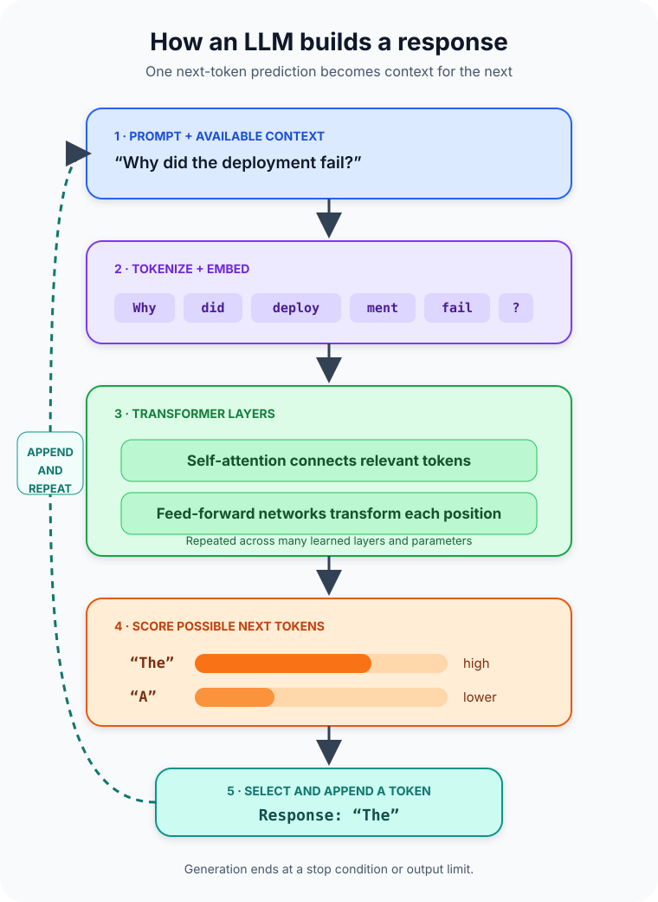

An AI assistant writes a confident answer about a company's refund policy. The sentences are clear, the tone is helpful, and the policy sounds plausible.

There is only one problem: the model was never connected to the company's policy database.

That gap between *sounding informed* and *being grounded in evidence* is the most important thing to understand about large language models. Their remarkable skill comes from learning patterns in language, not from storing a tidy library of verified facts or consulting a hidden search engine for every answer.

**A large language model, or LLM, is a neural network trained on vast amounts of text to predict and generate sequences of tokens.** Tokens are pieces of text, parameters are learned numerical values, and the model uses the surrounding context to estimate what token should come next. Repeating that prediction produces sentences, code, summaries, and conversations.

That definition sounds modest. The surprising part is how much useful behavior can emerge from the same prediction process when the model, training data, and computation become large enough.

## Start with a language model, not a chatbot

A language model estimates the probability of tokens in a sequence. Given “The server returned a 404 because the page was,” it might assign high probability to tokens such as “missing” or “not found” and low probability to an unrelated continuation such as “purple.”

Earlier statistical language models often counted short sequences called n-grams. Those models could capture local patterns, but longer context created a sparsity problem: exact long sequences rarely repeat enough to estimate reliably. Neural language models learn distributed representations instead of depending only on exact phrase counts.

The word **large** has no universal parameter threshold. It usually signals scale across several dimensions: many learned parameters, broad training data, substantial computation, and enough capacity to model complicated relationships in long sequences. A smaller, carefully trained model may outperform a larger one on a specific task, so parameter count is not a quality score by itself.

An LLM is also not the entire application. A chat product may add system instructions, safety filters, conversation storage, document retrieval, web search, calculators, code execution, and other tools. When an assistant quotes a current policy correctly, that answer may come from a retrieval system feeding evidence into the model—not from the model's parameters alone.

## Text becomes tokens, then numbers

Models do not receive words in the way a reader sees them. A **tokenizer** divides text into units that might be whole words, parts of words, punctuation, or individual characters. The exact split depends on the tokenizer and language.

For example, a tokenizer could represent `replaying` as pieces resembling `re`, `play`, and `ing`. Another tokenizer might split it differently. Tokens are not guaranteed to match words, and the same visible length can produce very different token counts across languages or kinds of text.

Each token ID is mapped to an **embedding**: a vector of numbers learned during training. The vector is not a dictionary definition. It is a position in a high-dimensional space that lets the network work with patterns and relationships mathematically. Positional information is added so the model can distinguish “dog bites person” from “person bites dog,” even though both sentences contain the same words.

This conversion is why a context window is measured in tokens rather than pages. The context window is the amount of input and generated output the model can consider in one interaction. It is working space, not permanent memory. Text outside that window is unavailable unless the surrounding application stores and reintroduces it.

## The Transformer connects each token to its context

Most modern LLMs are based on the **Transformer** architecture introduced in the 2017 paper [Attention Is All You Need](https://proceedings.nips.cc/paper_files/paper/2017/file/3f5ee243547dee91fbd053c1c4a845aa-Paper.pdf). Its key mechanism is attention: a way to calculate which positions in a sequence matter when building a representation for a particular token.

Consider the sentence “The deployment failed because **it** lacked a secret.” To interpret “it,” the model should connect the pronoun more strongly to “deployment” than to “secret.” **Self-attention** calculates relationships among tokens in the same sequence, allowing the representation of each token to incorporate relevant context.

A Transformer uses multiple attention heads, so different learned relationship patterns can be processed in parallel. It also contains feed-forward networks that transform each position's representation. Residual connections and normalization help information move through many stacked layers. The values learned throughout these operations are the model's parameters.

This does not mean a head contains a human-readable grammar rule or a parameter stores one fact. Knowledge is distributed across many values and interactions. Researchers can inspect patterns, but the model is not a database with a row for every sentence it can produce.

Common Transformer arrangements serve different goals:

| Architecture | Context behavior | Typical strength |
| --- | --- | --- |
| Encoder-only | Reads context in both directions | Classification and text representations |
| Decoder-only | Uses preceding tokens to predict the next token | Open-ended text and code generation |
| Encoder-decoder | Encodes an input, then generates an output | Translation and sequence-to-sequence tasks |

The architecture is only one layer of the story. What the model learns depends heavily on its data, objective, training process, and later adaptation.

## Pretraining teaches prediction

During **pretraining**, the model processes a large text corpus and repeatedly practices a prediction objective. An autoregressive model sees preceding tokens and predicts the next one. Other language models may learn by reconstructing masked or corrupted parts of an input.

At first, the predictions are poor. A loss function measures the error between the model's predicted probability distribution and the training target. Backpropagation calculates how the parameters contributed to that error, and an optimizer adjusts them slightly. This cycle happens over enormous numbers of token examples.

To reduce prediction error, the model must learn more than spelling. It benefits from recognizing syntax, document structure, styles, semantic relationships, code patterns, and many regularities represented in the training data. Those learned patterns make the same base model adaptable to summarization, translation, classification, question answering, and generation.

The 2020 paper [Language Models are Few-Shot Learners](https://papers.neurips.cc/paper/2020/hash/1457c0d6bfcb4967418bfb8ac142f64a-Abstract.html) demonstrated that a sufficiently scaled autoregressive model could perform many tasks from instructions and examples placed in its prompt, without updating its parameters for each task. This is called **in-context learning**. The prompt changes the active context and behavior for that request; it does not retrain the model.

## Post-training turns a predictor into an assistant

A pretrained model is optimized to continue text, not necessarily to answer clearly, follow instructions, decline unsafe requests, or admit uncertainty. **Post-training** adapts that base model toward desired behavior.

Methods can include supervised fine-tuning on examples of useful responses, preference-based optimization, and targeted safety training. The [InstructGPT research](https://arxiv.org/abs/2203.02155) is an influential example: researchers used demonstrations and human rankings to fine-tune models toward user intent, while also reporting that mistakes remained.

This distinction prevents a common misconception. Pretraining provides broad language capability. Post-training shapes how that capability is expressed. Retrieval and tools can then provide current evidence or actions. A polished assistant is therefore a layered system:

1. A base model predicts tokens from learned parameters and current context.
2. Post-training makes its responses more instruction-following and useful.
3. The application supplies prompts, data, tools, controls, and a user interface.

Changing any layer can change the result, even if the underlying model stays the same.

## How one response is generated

At inference time, the prompt and any application-supplied context are tokenized and passed through the model. The final layer produces a score for every possible next token. A softmax operation converts those scores into a probability distribution.

The system then selects a token. Always choosing the highest-probability option can make output predictable and repetitive. Sampling settings can allow lower-ranked tokens to be chosen, creating more variety. Temperature is one control over that distribution, but it does not add knowledge or make a weak answer factual.

The chosen token is appended to the sequence, and the model runs again to predict the following token. Generation stops when it reaches a stop condition or output limit. The diagram above shows this loop: one response is assembled token by token, not retrieved as a completed paragraph from inside the model.

This explains why identical prompts can produce different responses and why an early wording choice can steer everything that follows. Each selected token becomes part of the context for the next prediction.

## What LLMs do well—and where they fail

LLMs are useful when a task can benefit from flexible language transformation: drafting, summarizing, translating, classifying, extracting structure, explaining code, or exploring alternatives. One general model can often handle many of these tasks through instructions and examples.

But probability is not truth. A plausible continuation may contain a false date, nonexistent citation, insecure code path, or confident arithmetic mistake. NIST's [Generative AI Profile](https://doi.org/10.6028/NIST.AI.600-1) calls confidently presented false content **confabulation** and treats it as a risk requiring management, especially in consequential settings.

Other limits follow from how LLM systems are built:

- Training data can contain bias, errors, private information, or uneven representation.
- Parameters may encode stale patterns; a model does not automatically know what changed today.
- Limited context can omit a critical instruction or piece of evidence.
- Prompts and retrieved content can introduce security risks when models are connected to tools.
- Training and inference can require significant computing, energy, latency, and cost.
- Fluent explanations can invite more trust than evaluation results justify.

The practical response is not to dismiss the technology or trust it blindly. Match controls to consequences. Ground answers in approved sources, validate structured outputs, test on realistic cases, restrict tool permissions, monitor failures, and keep human review where an error could materially harm someone.

## Common misconceptions

**“It searches the internet for every answer.”** Not unless the application gives it browsing or retrieval tools. The model itself generates from parameters and current context.

**“It remembers every conversation.”** A model has no automatic personal memory. A product may store conversation history or user preferences and send them back in later prompts.

**“It copies a training document.”** LLMs learn distributed statistical patterns, but memorization and regurgitation can occur. Data governance and output testing still matter.

**“Bigger always means better.”** Scale can improve broad capability, but architecture, data quality, post-training, evaluation, latency, and task fit all matter. The best model is the one that meets the actual requirement under acceptable cost and risk.

**“If it explains its reasoning, the answer must be correct.”** Generated reasoning is also generated text. Treat it as material to verify, not an audit log of a guaranteed internal proof.

## The takeaway

A large language model is best understood as a learned next-token prediction engine with an unusually rich representation of language. Tokens turn text into units, embeddings turn those units into vectors, Transformer layers connect them through attention, and training adjusts billions of interacting parameters to improve prediction.

That mechanism can support remarkably general behavior. It does not turn probability into certainty.

The useful question is therefore not simply, “Can the LLM answer?” Ask what context it received, whether it has an authoritative source, what tools surround it, how its output was evaluated, and what happens when it is wrong. Those questions separate an impressive demonstration from a dependable system.

## Continue learning

- [What Is Generative AI and How Does It Work?](/posts/what-is-generative-ai/)
- [AI vs Machine Learning vs Deep Learning](/posts/ai-vs-machine-learning-vs-deep-learning/)
- [What Is Machine Learning and How Does It Work?](/posts/what-is-machine-learning/)
- [Model Context Protocol (MCP) Explained](/posts/model-context-protocol-explained-llms-real-world-data/)

## Sources

- [Google Machine Learning Crash Course: Introduction to Large Language Models](https://developers.google.com/machine-learning/crash-course/llm)
- [Google Machine Learning Crash Course: What's a Large Language Model?](https://developers.google.com/machine-learning/crash-course/llm/transformers)
- [NeurIPS: Attention Is All You Need](https://proceedings.nips.cc/paper_files/paper/2017/file/3f5ee243547dee91fbd053c1c4a845aa-Paper.pdf)
- [NeurIPS: Language Models are Few-Shot Learners](https://papers.neurips.cc/paper/2020/hash/1457c0d6bfcb4967418bfb8ac142f64a-Abstract.html)
- [arXiv: Training Language Models to Follow Instructions with Human Feedback](https://arxiv.org/abs/2203.02155)
- [NIST AI 600-1: Artificial Intelligence Risk Management Framework—Generative AI Profile](https://doi.org/10.6028/NIST.AI.600-1)
