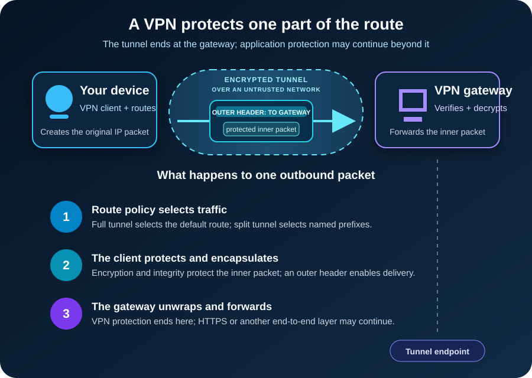

You join an airport Wi-Fi network, open your laptop, and switch on a VPN. A small icon changes, the connection says *protected*, and the Internet keeps working.

What actually changed?

Your laptop did not leave the airport network. It created a protected path *through* that network to another system: a VPN gateway. Selected traffic now travels inside that path before continuing toward a company network or the public Internet.

That is the shortest useful definition of a **virtual private network (VPN)**: a VPN uses a shared network, usually the Internet, to carry traffic between authenticated endpoints as though they had a private connection. The path is virtual because it is built in software rather than as a dedicated physical circuit. It is private because cryptography protects traffic while it crosses the untrusted part of the route.

The important phrase is *part of the route*. A VPN is a protected path, not an invisibility cloak.

## A VPN changes both protection and routing

Without a VPN, your device normally sends traffic toward its local router, which forwards it through an Internet service provider and onward to the destination. HTTPS may already protect the application data between your browser and a website, but the network still needs enough addressing information to deliver each packet.

When a VPN is active, the operating system gains a virtual network interface and one or more new routes. Those routes decide which packets enter the VPN. The VPN software then protects each selected packet and wraps it inside another packet addressed to the VPN gateway.

This creates two useful views of the same trip:

- The **inner packet** represents the original conversation, such as your device contacting an internal file server or a website.
- The **outer packet** carries the protected inner packet across the public network to the VPN gateway.

Routers between you and the gateway use the outer header. They can deliver the packet without reading the protected contents inside it. At the gateway, the outer wrapper is checked and removed. The gateway then forwards the original traffic toward its real destination.

The response follows the reverse path: destination to gateway, gateway through the protected tunnel, and tunnel back to your device.

This packet-inside-a-packet structure is called **encapsulation**. In IPsec tunnel mode, the [IETF IPsec architecture](https://www.rfc-editor.org/rfc/rfc4301.html) describes an outer IP header for the tunnel endpoints and an inner IP header for the original source and destination. Other VPN protocols implement the details differently, but the boundary remains the useful mental model.

## The tunnel begins with identity and keys

Encryption cannot help if your device builds a tunnel to an impostor. Before ordinary traffic flows, the VPN peers must establish who they are allowed to communicate with and create shared session keys.

Depending on the system, authentication may involve certificates, public keys, a username plus multifactor authentication, or a combination. The peers negotiate or derive fresh cryptographic keys, agree on the connection state, and then use those keys to protect data packets.

That protection normally provides three properties across the tunnel:

1. **Confidentiality:** an observer on the path cannot read the protected payload.
2. **Integrity:** modification in transit can be detected.
3. **Peer authentication:** each side can determine that it is communicating with an authorized endpoint.

[NIST SP 800-77 Rev. 1](https://csrc.nist.gov/pubs/sp/800/77/r1/final) describes IPsec as a network-layer security control and notes that IPsec configuration usually uses Internet Key Exchange, or IKE. IKE establishes security associations: the algorithms, keys, lifetimes, identities, and traffic rules needed for protected communication.

This setup step is why a VPN is more than “encrypt every packet with one password.” It is a living security relationship. Keys are established, traffic is selected by policy, counters prevent replay, and sessions eventually rekey or expire.

## Remote access and site-to-site VPNs solve different problems

The same tunnel idea appears in several shapes.

A **remote-access VPN** connects one device to a gateway. An employee at home can reach approved company subnets without exposing those internal services directly to the Internet. A consumer VPN uses a similar client-to-gateway shape but usually routes public Internet traffic through the provider's gateway.

A **site-to-site VPN** connects two network gateways. Devices in one office can communicate with devices in another office while the gateways handle protection. Individual laptops may not run VPN software because the network edge creates the tunnel on their behalf.

A **host-to-host tunnel** connects two individual systems. It is less visible to users, but the same questions still apply: which traffic enters, which identities are trusted, and where does protection end?

These forms can use more than one protocol family:

| VPN approach | Where it commonly fits | Distinguishing idea |
| --- | --- | --- |
| IPsec with IKEv2 | Remote access and site-to-site networking | Protects traffic at the IP layer; tunnel mode carries an inner IP packet |
| WireGuard | Remote access, site-to-site, and host tunnels | Associates peers with public keys and allowed IP ranges; carries encrypted packets over UDP |
| TLS-based VPN | Remote access through a gateway or client | Uses TLS-based channels, often with product-specific routing and access behavior |

The protocol name alone does not tell you whether the deployment is safe. Authentication, patching, cryptographic settings, route policy, endpoint security, and gateway exposure matter just as much.

## Full tunnel and split tunnel decide which road traffic takes

A VPN does not necessarily carry every packet.

With a **full-tunnel** configuration, the client sends its default Internet route through the VPN. Requests to internal systems and public websites both reach the VPN gateway first. This gives the organization or provider one exit point for filtering and monitoring, but it also increases the traffic and trust placed on that gateway.

With **split tunneling**, only selected destinations use the VPN. A route for `10.20.0.0/16`, for example, might send company traffic into the tunnel while ordinary web browsing leaves through the user's local connection. Split tunneling can reduce latency and gateway load, but policy, DNS, and monitoring become more complicated because the device uses two paths at once.

Neither choice is automatically correct. The right choice follows the threat model, access requirements, device management, and operational capacity.

## What can each observer still see?

Suppose a full-tunnel client opens an HTTPS website through a VPN.

The local Wi-Fi operator and Internet provider can generally see that the device exchanges traffic with a VPN endpoint. Packet timing, volume, and the gateway's public address remain observable even though the inner traffic is protected.

The VPN gateway removes the tunnel protection, so the operator of that gateway becomes part of the trust model. If the application also uses HTTPS, the website connection remains encrypted from the browser to the website; the VPN gateway forwards that encrypted application traffic. Without end-to-end application encryption, the gateway may be able to inspect content after the VPN layer ends.

The website sees a connection arriving from the gateway's public IP address, but it can still identify a signed-in account, receive cookies, or observe browser characteristics. Changing the visible source IP is not the same as becoming anonymous.

DNS follows its own configured path. A VPN may supply an internal resolver and route DNS through the tunnel, use split DNS so company names and public names go to different resolvers, or leave some lookups on the local network. A working tunnel with incorrect DNS policy can therefore look like a broken application.

The honest privacy claim is narrow: **a VPN protects selected traffic between its tunnel endpoints and changes where that traffic re-enters the wider network**. What happens before, after, and on the endpoints still matters.

## A VPN does not make a device trustworthy

A tunnel can carry malicious traffic as faithfully as legitimate traffic. If a laptop is already infected, if credentials are stolen, or if a user approves a phishing prompt, encryption does not repair the endpoint or the decision.

Traditional remote-access designs can also grant broad network reach after login. That makes the gateway an important security boundary, not a substitute for authorization. Restrict users to the resources they need, segment sensitive networks, monitor access, and apply authorization again at the application or service.

Internet-facing VPN gateways also need the ordinary discipline of exposed infrastructure. Current [CISA hardening guidance](https://www.cisa.gov/resources-tools/resources/enhanced-visibility-and-hardening-guidance-communications-infrastructure) recommends limiting gateway exposure, allowing only required ports, using strong cryptography, and disabling unused features and algorithms. CISA also recommends phishing-resistant multifactor authentication for accounts that access company systems.

In practical terms: patch the gateway, require strong authentication, remove stale accounts, protect administrative access, log important events, and test whether the configured routes are narrower than “the whole internal network.” A secure tunnel to an overprivileged account is still overprivileged access.

## Common failures reveal the real boundaries

When a VPN says *connected* but an application does not work, begin with the path rather than reinstalling the client.

If an IP address is reachable but a hostname is not, inspect DNS assignment and split-DNS rules. If internal traffic leaves through the local router, inspect the route table and the prefixes the gateway advertised. If small requests work but large transfers stall, tunnel overhead and path maximum transmission unit, or MTU, deserve attention. Encapsulation adds bytes; a path that cannot carry the larger outer packet may require fragmentation or a smaller effective MTU.

If all traffic stops as soon as the tunnel connects, check the default route, gateway reachability, firewall policy, and whether a kill switch intentionally blocks traffic outside the tunnel. If authentication fails, separate identity problems from packet forwarding: certificate validity, device time, account status, MFA, and authorization all happen before an application route can succeed.

The sequence is useful because “VPN connected” proves only that some tunnel state exists. It does not prove that the correct DNS server answered, that the needed subnet is routed, that the firewall permits the flow, or that the destination application accepts the user.

## The takeaway

A VPN creates a protected network path across infrastructure you do not control. It authenticates endpoints, establishes keys, selects traffic, encapsulates original packets, and carries them to a gateway that forwards them onward.

That is valuable for remote access, connecting sites, and reducing exposure on an untrusted local network. It also relocates trust. The local network sees less, the VPN gateway sees more, and destinations still know whatever the application and browser reveal.

Remember the boundary and the technology becomes easier to reason about: **a VPN protects traffic between tunnel endpoints; security beyond those endpoints needs its own controls.**

## Continue learning

- [Encryption vs Hashing vs Encoding](/posts/encryption-vs-hashing-vs-encoding/)
- [What Is Public Key Infrastructure (PKI)?](/posts/what-is-public-key-infrastructure/)
- [Router vs Switch vs Modem](/posts/router-vs-switch-vs-modem/)
- [Zero Trust Explained with Real-World Examples](/posts/zero-trust-explained-real-world-examples/)

## Sources

- [NIST SP 800-77 Rev. 1: Guide to IPsec VPNs](https://csrc.nist.gov/pubs/sp/800/77/r1/final)
- [IETF RFC 4301: Security Architecture for the Internet Protocol](https://www.rfc-editor.org/rfc/rfc4301.html)
- [WireGuard: Protocol and Cryptography](https://www.wireguard.com/protocol/)
- [CISA: Enhanced Visibility and Hardening Guidance for Communications Infrastructure](https://www.cisa.gov/resources-tools/resources/enhanced-visibility-and-hardening-guidance-communications-infrastructure)
