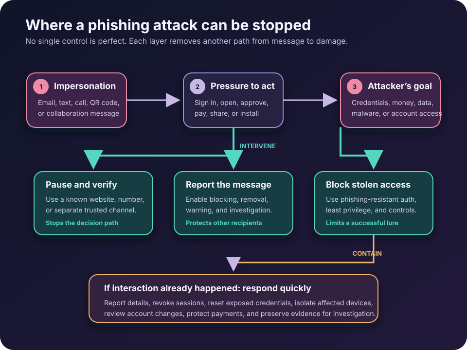

The message looks ordinary because ordinary is the disguise.

It might be a password-expiration notice, a shared document, a delivery problem, or a short request from a manager. The logo is familiar. The timing is plausible. The message asks for one small action: open this file, sign in here, approve this prompt, or send the payment now.

That small action is the attack.

**Phishing is a form of social engineering in which an attacker impersonates a trusted person or organization to make someone reveal information, transfer value, install malware, or grant access.** Email is the classic delivery channel, but the same technique can arrive through text messages, phone calls, social media, collaboration tools, search results, and QR codes.

Phishing matters because it does not need to defeat encryption or discover a software flaw. It tries to make a legitimate user perform an attacker’s next step. Prevention therefore cannot depend on perfect human suspicion. It has to combine safer decisions with systems that limit what one mistake can do.

## Phishing is an attack on context

A phishing message usually borrows three things: an identity, a believable situation, and pressure.

The identity might be a bank, cloud provider, colleague, supplier, government agency, or family member. The situation gives the request a reason: an invoice is overdue, a mailbox is full, a benefits document is waiting, or a payment account has changed. Pressure narrows the recipient’s attention with urgency, authority, fear, secrecy, or an attractive reward.

This explains why a polished message can still be malicious and an awkward message can still succeed. Grammar is only one signal. A capable attacker may copy genuine branding, register a look-alike domain, compromise a real account, reuse an existing conversation, or collect public details before making contact.

The joint [CISA phishing guidance](https://www.cisa.gov/sites/default/files/2025-03/Phishing%20Guidance%20-%20Stopping%20the%20Attack%20Cycle%20at%20Phase%20One%20508.pdf) describes two common goals: stealing login credentials for initial access and delivering malware for later activity. The same trust-manipulation pattern can also redirect payments, steal personal data, capture one-time codes, or persuade someone to approve an access request.

The useful question is not merely, “Does this email look strange?” It is, **“Is this request and this channel appropriate for the action I am being asked to take?”**

## What happens during a phishing attack?

Consider a fake cloud-storage notification.

The attacker sends a message saying that a document has been shared. Its button opens a page that resembles the real sign-in screen. The victim enters a username and password, and the fake site sends those credentials to the attacker. A more advanced adversary-in-the-middle site may relay the login to the real service and ask for a one-time MFA code as well.

If the login succeeds, the attacker may read mail, steal files, reset other accounts, create forwarding rules, or send more convincing messages from the compromised account. A message from a real colleague’s mailbox is harder to dismiss than one from an unknown sender.

Other campaigns replace the fake login with an attachment or download. Opening it may execute malicious code, exploit an unpatched application, or convince the user to enable a dangerous feature. In payment fraud, no malware or credential page is necessary: the attacker simply invents or intercepts a business request and supplies new bank details.

Different payloads, same design: borrowed trust leads to a consequential action.

## The common forms of phishing

The names describe delivery methods or targeting, not entirely different attacks.

| Form | How it reaches the target | Typical pretext or goal |
| --- | --- | --- |
| Email phishing | Broad or targeted email | Fake sign-in, invoice, attachment, or account warning |
| Spear phishing | A tailored message to a specific person or team | Access to a valuable account, system, or business process |
| Smishing | SMS or another text-messaging channel | Delivery notice, unpaid toll, account alert, or urgent link |
| Vishing | Phone or voice message | Impersonated support, bank, executive, or government official |
| Business email compromise | Spoofed or compromised business identity | Payment diversion, payroll change, gift cards, or sensitive data |
| Quishing | QR code leading to a site | Moving the victim from a message or physical sign to a fake login |

Attackers mix these channels. A phone caller may direct someone to an email, or a message may request a call to a fraudulent number. The channel can change halfway through while the invented story stays intact.

## How can you recognize a phishing attempt?

Look for a mismatch between the message and the action, not one magical giveaway.

An unexpected request for a password, recovery code, financial information, remote access, or secrecy deserves a pause. So does a sudden change to payment instructions, a login link you did not request, an MFA prompt you did not initiate, or an attachment that requires unusual steps to open.

Check the actual sender address and destination domain, but read from right to left around the registered domain. `accounts.example.com` belongs to `example.com`; `example.account-check.com` belongs to `account-check.com`. Mobile screens and display names can hide this distinction, and visually similar characters make casual inspection harder.

Still, a familiar address does not prove safety. Email can be spoofed, and real mailboxes can be compromised. A valid HTTPS lock only means the connection to that site is encrypted; it does not mean the site is honest.

The UK National Cyber Security Centre recommends making important processes resistant to phishing by [verifying email requests through a second form of communication](https://www.ncsc.gov.uk/guidance/phishing). Independent verification through a known number, saved website, or separate trusted channel breaks the attacker’s control of the conversation.

## What should you do with a suspicious message?

Do not click its links, open its attachments, reply, call a supplied number, or scan its QR code. Use the service’s saved bookmark or type its known address yourself. For a workplace request, confirm it through a separate trusted channel, especially when money, credentials, confidential data, or account changes are involved.

Then report the message through the mail or collaboration platform and follow the organization’s incident process. Reporting is more useful than silent deletion: defenders may be able to remove matching messages, block a destination, warn other recipients, and identify anyone who already interacted with it.

Delete the message only after reporting or preserving it as required. Do not forward a suspicious attachment casually to colleagues; use the designated reporting mechanism so the dangerous content stays inside the security workflow.

This sequence is worth remembering: **pause, verify independently, report, then remove**.

## Prevention needs more than awareness training

Training helps people recognize pressure and gives them a safe way to challenge unusual requests. It should use realistic business situations and reward early reporting, not shame the person who clicked. But training cannot inspect every URL perfectly, prevent a compromised supplier from writing convincingly, or make a tired employee infallible.

Technical and process controls should assume that some messages will pass filters and some people will act on them.

Start with authentication. Ordinary MFA is generally better than a password alone, but one-time codes and simple approval prompts can be relayed or socially engineered. [NIST SP 800-63B-4](https://pages.nist.gov/800-63-4/sp800-63b.html#phishing-resistance) defines phishing resistance as an authentication protocol preventing disclosure of usable secrets or authenticator outputs to an impostor without relying on the user’s vigilance. It explicitly does not treat manually entered OTP methods as phishing-resistant.

For high-value accounts, use passkeys, FIDO2 security keys, or another appropriately deployed cryptographic authenticator that binds authentication to the legitimate service. The distinction is explained further in [MFA vs Passwordless vs Passkeys](/posts/mfa-vs-passwordless-vs-passkeys/). Protect enrollment and recovery too; a strong daily login is undermined by a weak help-desk reset.

Email-domain controls matter as well. SPF identifies authorized sending infrastructure, DKIM adds a domain-associated signature, and DMARC evaluates alignment and tells receivers how the domain owner wants failures handled. The current [DMARC specification, RFC 9989](https://www.rfc-editor.org/rfc/rfc9989.html), is explicit about the boundary: DMARC can combat exact-domain spoofing, but it does not stop look-alike domains, display-name abuse, or every fraudulent message.

Organizations also need filtering and attachment controls, prompt patching, endpoint protection, least privilege, restricted scripting and macros where appropriate, and monitoring for suspicious sign-ins or mailbox changes. Sensitive workflows need their own defenses: known-vendor payment details, out-of-band confirmation for changes, dual approval, and a rule that urgency never bypasses verification.

The goal is not a perfect gate. It is a sequence of barriers:

- reduce the number of malicious messages that arrive;
- make dangerous requests easier to question and report;
- make stolen passwords less useful;
- limit the access of a compromised account or device;
- detect misuse quickly and contain it.

This is [defense in depth](/posts/zero-trust-explained-real-world-examples/) applied to human-facing communication.

## What if you already clicked?

Clicking is not the same as compromise, but waiting turns uncertainty into risk. Stop interacting with the page or file and contact the organization’s security or IT team immediately. Tell them what happened, when it happened, which device and account were involved, and what information you entered or approved.

If you entered a password, change it through the legitimate service from a trusted device and revoke active sessions where possible. Change any other account that reused the password. If you approved an MFA request, shared a recovery code, installed software, opened a suspicious attachment, or granted an application permission, say so explicitly; each event changes the response.

Do not erase evidence, uninstall tools, or factory-reset a work device unless responders direct you to. They may need message headers, the URL, the file, process data, or sign-in records. For a personal device, update its security software and run the recommended scan; if financial or identity information was exposed, contact the relevant institution through a known channel and use the official fraud or identity-theft reporting service for your country.

Fast reporting can let defenders reset sessions, remove malicious inbox rules, isolate a device, block infrastructure, reverse a payment, or warn other targets. Hiding the mistake helps only the attacker.

## Common anti-phishing mistakes

The first mistake is teaching people that bad spelling proves phishing. It can be a clue, but polished messages and compromised accounts remove it.

The second is treating every MFA method as equally resistant. SMS and one-time codes can limit damage from a stolen password, yet a real-time phishing site may capture or relay them. Use phishing-resistant methods for the accounts that matter most.

The third is trusting the sender name, the logo, HTTPS, or a familiar conversation by itself. Each can exist in a malicious interaction.

The fourth is making reporting difficult or punitive. A prominent report button and a calm response shorten the time between suspicion and containment.

The last is buying an email filter and declaring the problem solved. Phishing can move through phones, text messages, QR codes, social networks, compromised accounts, and legitimate file-sharing services. The defense has to protect identities and business processes, not only inboxes.

## The takeaway

Phishing succeeds by making an unsafe action feel normal, urgent, or authorized. The best personal habit is to move important requests out of the attacker-controlled channel: pause, reach the person or service through a path you already trust, and report the attempt.

The best organizational strategy is to make that habit only one layer. Use phishing-resistant authentication, protect domains, filter messages, harden devices, constrain privileges, verify sensitive changes, and prepare a rapid response.

You do not prevent phishing by expecting everyone to recognize every fake. You prevent a phish from becoming an incident by giving one deceptive message fewer chances to succeed.

## Continue learning

- [MFA vs Passwordless vs Passkeys: What Is the Difference?](/posts/mfa-vs-passwordless-vs-passkeys/)
- [Authentication vs Authorization](/posts/authentication-vs-authorization/)
- [Zero Trust Explained With Real-World Examples](/posts/zero-trust-explained-real-world-examples/)
- [SIEM vs XDR vs SOAR: What They Do and When to Use Each](/posts/siem-vs-xdr-vs-soar/)

## Sources

- [CISA, NSA, FBI, and MS-ISAC: Phishing Guidance—Stopping the Attack Cycle at Phase One](https://www.cisa.gov/sites/default/files/2025-03/Phishing%20Guidance%20-%20Stopping%20the%20Attack%20Cycle%20at%20Phase%20One%20508.pdf)
- [UK National Cyber Security Centre: Phishing Attacks—Defending Your Organisation](https://www.ncsc.gov.uk/guidance/phishing)
- [NIST SP 800-63B-4: Authentication and Authenticator Management](https://pages.nist.gov/800-63-4/sp800-63b.html#phishing-resistance)
- [RFC 9989: Domain-Based Message Authentication, Reporting, and Conformance (DMARC)](https://www.rfc-editor.org/rfc/rfc9989.html)
