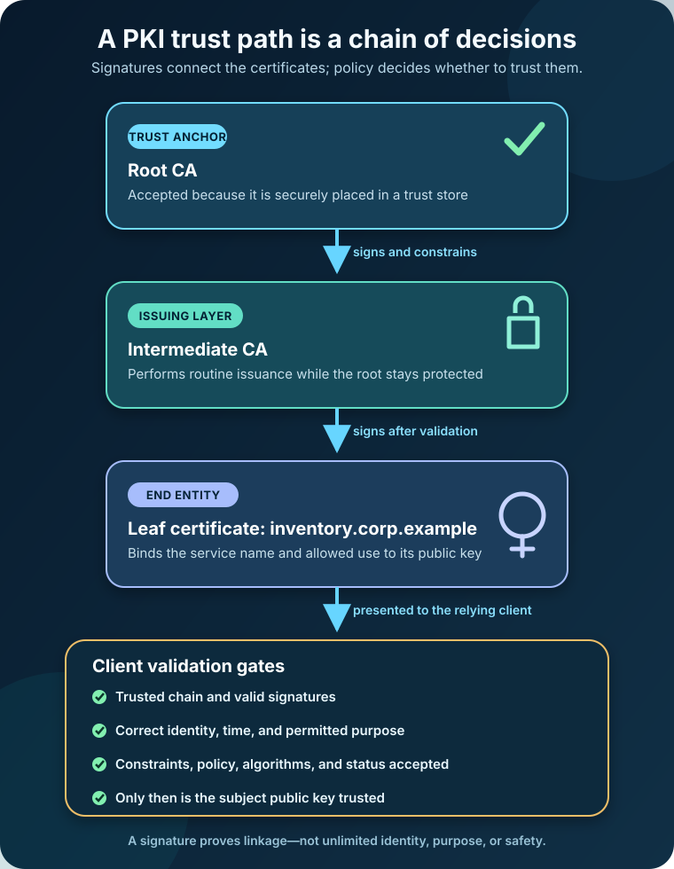

A server sends you a public key and says, “Use this to talk to me securely.”

The key may be perfectly valid. The mathematics may be sound. But one question remains: **why should you believe the key belongs to that server?**

An attacker can generate a convincing key pair too. If your browser accepts whichever public key arrives first, encryption may protect the conversation beautifully—between you and the attacker.

Public key infrastructure, or PKI, exists to solve that identity problem at scale. It combines public-key cryptography with certificates, trusted authorities, policies, repositories, and lifecycle controls. The result is not blind trust in a key. It is a repeatable way to decide whether a key is acceptable for a particular identity and purpose.

**PKI is the system that binds public keys to identities and lets relying parties validate those bindings.** It supports familiar technologies such as HTTPS, signed software, secure email, device identity, and enterprise authentication.

## A public key is not an identity

Asymmetric cryptography gives an entity a related key pair. The private key must remain under the owner's control; the public key can be distributed. A private-key operation can create a signature that the matching public key verifies, or the pair can participate in an approved key-establishment scheme.

What the key pair does **not** provide on its own is a trustworthy name.

Suppose `shop.example` publishes a public key. You still need evidence that the domain's authorized operator controls the corresponding private key. A digital certificate supplies a signed binding between that public key and information about its subject, along with limits such as its validity period and permitted uses.

[RFC 5280](https://www.rfc-editor.org/rfc/rfc5280.html) describes the Internet X.509 certificate and certificate revocation list profile. Its model includes end entities, certification authorities, optional registration authorities, revocation-list issuers, and repositories. That is why PKI is called an *infrastructure*: the certificate file is only one artifact inside a larger trust and operating system.

## The parts of a PKI

The names sound formal, but each component answers a practical question.

| Component | What it contributes |
| --- | --- |
| Subject or subscriber | Holds or controls the private key and requests a certificate for a person, service, device, or organization |
| Registration authority (RA) | Performs delegated identity or authorization checks before issuance; it is optional |
| Certification authority (CA) | Signs certificates and communicates their status under defined policies |
| Repository or status service | Distributes certificates, intermediate certificates, CRLs, or OCSP responses |
| Relying party | Validates a certificate before trusting the bound public key |
| Trust store | Contains trust anchors that an operating system, browser, application, or organization has chosen to trust |

The **root CA** sits at the top of a common hierarchical PKI. Its public key is a trust anchor. Root certificates are often self-signed, but the self-signature is not what makes them trustworthy. Software or an administrator trusts a root because it was distributed through an authenticated process and accepted under policy.

Day-to-day certificates are usually issued by **intermediate CAs**, not directly by the root. This separation lets the root private key remain heavily protected and often offline. If an intermediate must be replaced or constrained, the root can remain the stable trust anchor.

At the bottom is the **leaf certificate**, also called an end-entity certificate. It may identify a TLS server, user, code-signing identity, device, or another non-CA subject. A leaf certificate should not gain the authority to issue more certificates merely because it contains a public key; X.509 constraints distinguish CA certificates from end entities and limit permitted uses.

## How a certificate is issued

Imagine an internal service named `inventory.corp.example` that needs a certificate for mutual TLS.

First, the service or its managed key system generates a key pair. Keeping generation near the eventual key holder avoids transporting the private key. The service then submits an enrollment request containing its public key and requested identity information. A certificate signing request is a common format, but it is not approval by itself.

Next, the PKI validates whatever its policy requires. An RA might confirm that the workload is authorized to use the service name. A public TLS CA instead follows domain-control and other validation rules applicable to publicly trusted server certificates. Proof that the requester possesses the private key is important, but possession alone does not prove that the requested identity should be granted.

After validation, the issuing CA creates and signs the certificate with its own private key. The result typically includes the subject public key, issuer, serial number, validity interval, names, key-usage constraints, and other extensions. The service installs the leaf certificate and normally provides the necessary intermediate certificate or certificates to clients.

The private key never belongs in the certificate. Certificates are meant to be distributed. The private key is the sensitive asset whose loss, copying, or misuse can defeat the identity the certificate represents.

## How certificate-chain validation works

When a client connects, the server presents its leaf certificate and usually its intermediate chain. The client tries to build a certification path from the leaf through one or more intermediate CAs to a trust anchor it already accepts.

That process is more than checking a stack of signatures. In a typical TLS use, the client also asks:

- Is the certificate valid at the current time?
- Does the requested hostname match an authorized name in the certificate?
- Is the certificate allowed to authenticate a server?
- Did each issuer sign the next certificate in the path?
- Are CA status, basic constraints, name constraints, path-length limits, and policy rules satisfied?
- Are the algorithms and key parameters acceptable to this client and policy?
- Is relevant revocation or certificate-status information acceptable?

A valid CA signature therefore does not mean “trust this certificate for everything.” Trust is scoped. A certificate can be cryptographically genuine yet unacceptable because it is expired, names the wrong host, has the wrong extended key usage, violates a constraint, or chains to a root outside the client's trust store.

This also explains why one certificate can work on one machine and fail on another. The clients may have different trust anchors, clocks, policies, intermediate caches, or supported algorithms.

## What PKI does during HTTPS

PKI is often described as “the encryption behind HTTPS,” but that wording hides the division of labor.

The server certificate helps the browser authenticate the server's public key. The TLS handshake then uses asymmetric mechanisms to authenticate participants and establish shared secret keying material. Symmetric authenticated encryption protects the application traffic efficiently after the handshake.

The certificate does not encrypt every web page, and a CA does not sit in the middle of every connection. The CA makes a signed assertion in advance. The browser evaluates that assertion locally when it builds and validates the chain.

For a deeper look at the cryptographic roles, see [Symmetric vs Asymmetric Encryption](/posts/symmetric-vs-asymmetric-encryption/). The distinction matters because rotating a certificate, rotating a private key, and changing a TLS session key are related but separate operations.

## Expiration and revocation solve different problems

Every certificate has a validity interval. Expiration limits how long clients may accept its binding without a new certificate. Renewal or reissuance creates a new certificate, and it may also introduce a new key pair.

**Revocation** is an attempt to declare a certificate unacceptable before its scheduled expiration—perhaps because the private key was compromised, the subject is no longer authorized, or the certificate was issued incorrectly.

Two familiar status mechanisms are:

- A **certificate revocation list (CRL)**, which is a CA-signed list of revoked certificate serial numbers and related data.
- The **Online Certificate Status Protocol (OCSP)**, standardized in [RFC 6960](https://www.rfc-editor.org/rfc/rfc6960.html), through which a client can request status for an identified certificate from a responder.

Revocation is not a magic delete button. Certificates and status data may be cached, clients may be offline, and application behavior can differ when a status service is unavailable. A sound design combines appropriately short lifetimes, automated renewal, protected keys, rapid incident response, and status mechanisms suited to the environment.

Public Web PKI adds another visibility mechanism: Certificate Transparency. [RFC 9162](https://www.rfc-editor.org/rfc/rfc9162.html) defines publicly auditable logs intended to expose issued TLS certificates so suspicious issuance can be noticed. Transparency helps detect problems; it does not replace certificate-path validation or private-key protection.

## Public PKI and private PKI are different trust domains

A public website needs certificates that ordinary browsers can validate without organization-specific setup. Publicly trusted CAs operate under browser root-program policies and industry requirements. The [CA/Browser Forum Baseline Requirements](https://cabforum.org/working-groups/server/baseline-requirements/about/) apply to publicly trusted TLS server certificates, while browser programs make their own root-store decisions. Mozilla's current [Root Store Policy](https://www.mozilla.org/en-US/about/governance/policies/security-group/certs/policy/) is one concrete example of those operational and audit expectations.

A private PKI serves a controlled environment: employee devices, internal services, network equipment, or enterprise workloads. The organization distributes its own trust anchor to managed clients and defines its own enrollment and certificate policies.

Installing a private root is powerful. Any CA trusted for a purpose can potentially authorize identities within its permitted scope. That makes root distribution, CA constraints, access controls, audit logs, backups, and key ceremonies security boundaries—not administrative details.

## PKI is a lifecycle, not a certificate purchase

The hardest PKI failures often happen after successful issuance. A forgotten certificate expires. A decommissioned server keeps a copy of a live private key. An intermediate chain is omitted. Revocation endpoints become unreachable. Nobody knows which application owns a certificate discovered during an incident.

[NIST SP 800-57 Part 1 Revision 5](https://csrc.nist.gov/pubs/sp/800/57/pt1/r5/final) treats key management as a lifecycle problem, including generation, distribution, storage, use, replacement, recovery where appropriate, revocation, and destruction. [RFC 3647](https://www.rfc-editor.org/rfc/rfc3647.html) similarly provides a framework for certificate policies and certification practice statements—the rules a PKI promises and the practices used to implement them.

For a small internal PKI, the practical checklist is still demanding:

- Inventory certificates, keys, owners, locations, purposes, issuers, and expiration dates.
- Automate enrollment and renewal instead of depending on calendar reminders.
- Protect CA and subscriber private keys according to the damage their misuse could cause.
- Separate approval, issuance, and administration where the risk justifies it.
- Monitor failed renewals, unusual issuance, status services, and upcoming expirations.
- Test revocation and CA-recovery procedures before an incident.
- Remove trust anchors and credentials when systems or relationships end.

## Common PKI mistakes

The first mistake is treating a self-signed certificate as inherently unsafe or a CA-signed certificate as inherently safe. The useful question is whether the trust anchor, identity checks, constraints, and operating policy fit the use case.

The second is copying private keys between systems for convenience. Shared keys blur accountability and enlarge the impact of compromise. When possible, each workload should generate and protect its own key pair.

The third is checking only expiration. A certificate may be current but still have the wrong name, purpose, issuer, chain, or status.

The fourth is deploying the leaf certificate without the required intermediates. A developer's browser may succeed because it cached the missing certificate, while a fresh client fails to build the path.

The fifth is building a private CA before designing enrollment, renewal, revocation, ownership, and recovery. Creating a root certificate is easy. Operating a trustworthy infrastructure for years is the real project.

## The takeaway

Public-key cryptography gives us keys and signatures. PKI adds the machinery needed to decide whose key we are seeing, what it may be used for, how long that statement remains valid, and which authority we are willing to trust.

The central idea is a constrained path, not a universal badge of safety: a relying party starts with a trust anchor, validates each signed link, checks identity and purpose, and applies current policy. When any required link or condition fails, trust should fail with it.

That is how PKI turns a public key from an anonymous mathematical object into an identity claim a system can evaluate.

## Continue learning

- [Symmetric vs Asymmetric Encryption: What Is the Difference?](/posts/symmetric-vs-asymmetric-encryption/)
- [Encryption vs Hashing vs Encoding: What Is the Difference?](/posts/encryption-vs-hashing-vs-encoding/)
- [Authentication vs Authorization: What Is the Difference?](/posts/authentication-vs-authorization/)
- [DNS Explained: How Your Browser Finds a Website](/posts/dns-explained-how-your-browser-finds-a-website/)

## Sources

- [IETF RFC 5280: Internet X.509 PKI Certificate and CRL Profile](https://www.rfc-editor.org/rfc/rfc5280.html)
- [NIST SP 800-57 Part 1 Rev. 5: Recommendation for Key Management](https://csrc.nist.gov/pubs/sp/800/57/pt1/r5/final)
- [IETF RFC 6960: Online Certificate Status Protocol](https://www.rfc-editor.org/rfc/rfc6960.html)
- [IETF RFC 3647: Certificate Policy and Certification Practices Framework](https://www.rfc-editor.org/rfc/rfc3647.html)
- [IETF RFC 9162: Certificate Transparency Version 2.0](https://www.rfc-editor.org/rfc/rfc9162.html)
- [CA/Browser Forum: About the Baseline Requirements](https://cabforum.org/working-groups/server/baseline-requirements/about/)
- [Mozilla Root Store Policy](https://www.mozilla.org/en-US/about/governance/policies/security-group/certs/policy/)
