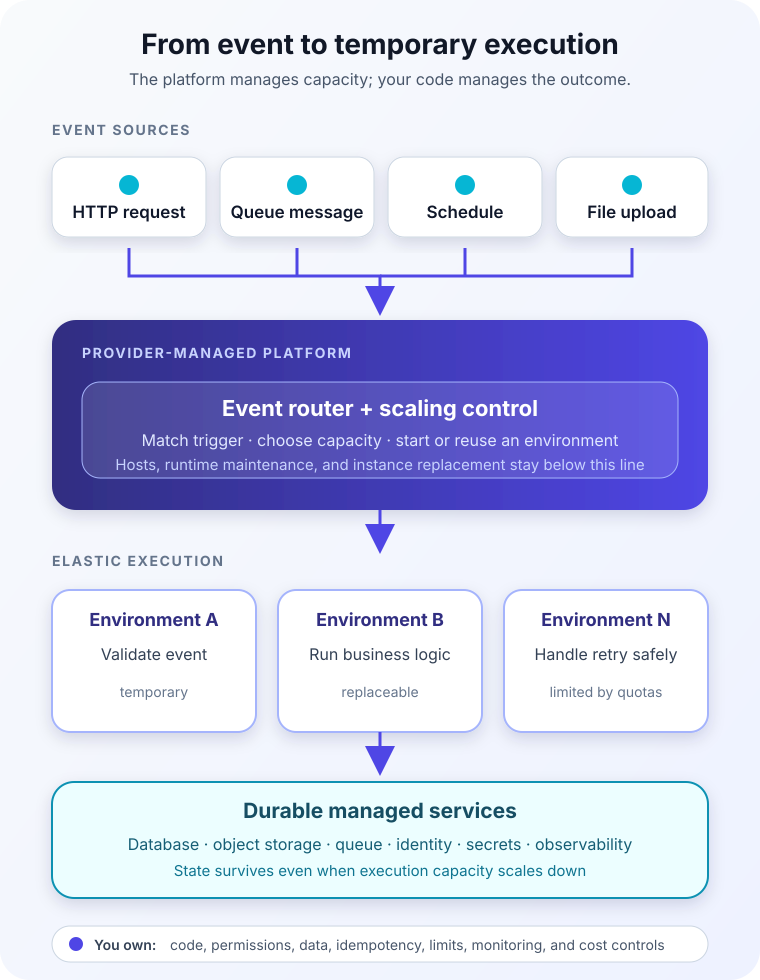

A small photo-sharing application receives almost no traffic overnight. At lunchtime, a promotion sends thousands of people to it at once. Every uploaded image needs a thumbnail, but keeping a fleet of thumbnail servers running all day would waste money. Guessing the lunchtime peak would be fragile.

This is the tension serverless computing is designed to relieve.

Instead of choosing a server size and deciding how many copies should stay online, the team deploys code or a container and connects it to an event. An upload arrives, the platform starts enough execution capacity to process it, and that capacity can shrink when the work disappears.

The name is misleading, though. **Serverless computing does not eliminate servers. It moves server provisioning, operating-system maintenance, and much of the capacity management behind a provider-controlled service boundary.** You still design, secure, deploy, observe, and pay for an application. You simply operate it at a different level.

## Serverless is an operating model, not a location

The [Cloud Native Computing Foundation](https://www.cncf.io/blog/2018/02/14/cncf-takes-first-step-towards-serverless-computing/) describes serverless as building and running applications without managing servers, with execution scaled and billed in response to demand. That definition highlights three characteristics that matter more than any product name:

- You do not provision or patch the underlying hosts.
- Capacity expands and contracts in response to requests, events, or configured demand.
- Consumption is measured more finely than a permanently allocated machine, although the exact billing unit depends on the service and plan.

Serverless is therefore broader than *functions*. Function as a Service, or FaaS, runs relatively small handlers in response to events. Backend as a Service, or BaaS, supplies managed capabilities such as identity, object storage, databases, queues, and API gateways. A serverless application commonly combines both.

Container platforms can also be serverless. [Google Cloud Run](https://docs.cloud.google.com/run/docs/overview/what-is-cloud-run), for example, accepts containers while managing the cluster and scaling infrastructure. The useful test is not whether a container exists. It is whether your team manages the machines and capacity beneath it.

## What happens when an event arrives?

Return to the photo application. Its thumbnail component does not continuously ask storage whether a new image exists. Upload storage emits an event. The platform routes that event to the configured handler and supplies an execution environment.

The flow looks simple because the platform absorbs a surprising amount of work:

1. An HTTP request, queue message, schedule, or storage change creates an event.
2. A managed router matches that event to a function or service.
3. The platform uses an existing execution environment or starts another one.
4. Your code validates the event, performs business logic, and calls durable services.
5. The platform records execution signals and removes idle capacity according to its scaling rules.

That final destination matters. An execution environment can be reused, but it is not a reliable home for application state. [AWS Lambda's execution model](https://docs.aws.amazon.com/lambda/latest/dg/concepts-how-lambda-runs-code.html) includes initialization, invocation, and shutdown. Cloud Run likewise documents its container file system as disposable. Durable records belong in a database, object store, or another service designed to preserve them.

This leads to a practical rule: treat memory and local files as temporary caches, not as the source of truth.

## The responsibility boundary moves; it does not disappear

A traditional virtual machine gives a team control over the guest operating system. That control comes with patching, capacity planning, process supervision, and scaling work. A serverless service takes many of those tasks, but it cannot take responsibility for the application itself.

| The provider typically manages | Your team still manages |
| --- | --- |
| Physical hosts and base infrastructure | Business logic and correctness |
| Runtime capacity and instance replacement | Identity, permissions, and secrets |
| Host and managed-runtime maintenance | Data classification and retention |
| Service-level scaling machinery | Timeouts, retries, and idempotency |
| Platform health signals and integrations | Observability, cost controls, and incident response |
| Availability of the managed service | Architecture across services and regions |

The exact line varies. Some offerings let you select only a language runtime; others run an arbitrary container. Some can scale to zero; others keep minimum capacity warm. Some use request-based billing, while premium or dedicated plans reserve resources. “Serverless” does not promise one universal configuration.

It also does not mean “zero operations.” A missing index can still make a database slow. Excessive permissions can still expose data. A recursive event can still create an expensive invocation storm. A dependency outage can still exhaust every function waiting on a timeout.

The work moves upward: fewer operating-system tickets, more attention to events, policies, service limits, failure behavior, and spend.

## Automatic scaling changes the failure shape

Traditional scaling often asks, “How many instances should we run?” Serverless scaling asks, “How much concurrent work can the whole path safely absorb?”

Suppose one photo upload triggers one thumbnail invocation. A sudden batch of 20,000 uploads may cause the compute layer to add capacity quickly. That sounds ideal until every invocation opens a database connection. The function tier can scale faster than the database, third-party API, or network path behind it.

Concurrency limits, queue buffering, batch sizes, backpressure, and downstream connection pools become architectural controls. [AWS documents](https://docs.aws.amazon.com/lambda/latest/dg/scaling-behavior.html) both automatic Lambda scaling and limits on how quickly execution environments can be added. The exact numbers are product details; the durable lesson is that scaling is neither infinite nor instantaneous.

Scaling down has a consequence too. If a service reaches zero active instances, the next request may wait while an execution environment starts. This is commonly called a *cold start*. Startup time depends on the platform, runtime, package, configuration, and workload. Keeping minimum instances ready can reduce that latency, but it gives up some scale-to-zero savings.

Serverless therefore fits asynchronous work especially well. A thumbnail job can wait briefly in a queue without making the upload request wait. A customer-facing API with strict tail-latency requirements may need warm capacity, careful startup optimization, or a different compute model.

## Retries make idempotency essential

Distributed systems sometimes lose acknowledgements. A function may complete its database update, but the event source may not learn that it succeeded. Retrying is often safer than silently losing work, so the same event can arrive again.

Your code must decide whether “again” is harmless.

Imagine an event with the identifier `upload-7f31`. Before creating a thumbnail record, the handler can make that identifier part of a uniqueness check. If the event is delivered twice, the second invocation finds the completed result rather than creating another record or charging a customer again.

This property is called **idempotency**: processing the same logical request more than once has the same intended effect as processing it once. Both [AWS Lambda best practices](https://docs.aws.amazon.com/lambda/latest/dg/best-practices.html) and [Azure Functions reliability guidance](https://learn.microsoft.com/en-us/azure/reliability/reliability-functions) recommend designing for it.

Reliable event handling also needs bounded retries, a destination for work that repeatedly fails, and enough context in logs to trace one event across services. Otherwise automatic retry turns a visible error into an invisible loop.

## When serverless is a strong fit

Serverless works best when demand is intermittent or uneven, work can be divided into independent executions, and the application can keep durable state outside the compute environment.

Good candidates include image or document processing after an upload, scheduled maintenance tasks, webhook handlers, queue consumers, data transformation, lightweight APIs, and integrations that react to changes in managed services. These workloads benefit from event routing and fine-grained scaling without requiring a permanently staffed fleet.

It is less comfortable when a workload needs a long-lived process, specialized host access, highly predictable low latency from every request, large amounts of local durable state, or steady utilization that may be simpler to run on reserved capacity. Platform execution limits, supported runtimes, networking behavior, deployment packaging, and local testing experience also deserve evaluation.

The choice is not binary. A web application can run on containers while its upload processing uses functions. A long-running service can publish work to a serverless consumer. A serverless API can call a conventional database. Architecture is allowed to follow workload boundaries.

## Cost follows activity, including mistakes

Fine-grained billing is attractive because idle compute can approach zero on some plans. But low traffic does not guarantee a low total bill. Requests, execution duration, memory, logs, storage, data transfer, queues, gateways, databases, and minimum instances can all contribute.

More importantly, serverless converts software behavior directly into resource consumption. A retry loop, noisy event source, unbounded fan-out, or slow dependency can multiply invocations. Cost controls should therefore look like reliability controls: budgets and alerts, concurrency caps, maximum retry counts, message retention, log sampling, and load tests that include downstream systems.

Compare complete architectures rather than a function's headline price. At steady high utilization, a continuously running service may be economical. At irregular demand, paying for brief execution and avoiding fleet operations may be far more valuable than the raw compute difference.

## Common serverless mistakes

The first mistake is assuming the platform makes code stateless automatically. It does not. A global variable or temporary file may survive one invocation and vanish before the next, producing bugs that appear only under scaling.

The second is letting every function talk to every service. Small deployment units can still form a tightly coupled distributed monolith. Clear ownership, stable event contracts, and a modest number of meaningful boundaries matter more than function count.

The third is ignoring local and production differences. Managed triggers, identity, networking, and retry policies may behave differently from a direct local call. Test the event envelope and failure path, not only the handler's happy path.

The fourth is treating observability as optional. A request may cross an API gateway, function, queue, second function, and database. Structured logs, correlation identifiers, metrics for errors and throttling, and traces are what turn that chain back into one understandable operation.

## A decision you can explain

Before choosing serverless, describe the workload in plain language. What triggers it? Can executions be independent? Where will durable state live? What happens when an event is duplicated? How much latency can a fresh instance add? Which downstream service becomes the bottleneck? What are the platform's current time, payload, concurrency, networking, and regional limits?

Then compare the operational boundary with the alternatives. [Virtual machines and containers](/posts/virtual-machines-vs-containers/) provide different control and isolation. [IaaS, PaaS, and SaaS](/posts/iaas-vs-paas-vs-saas/) help locate the broader responsibility line. [Message queues](/posts/message-queues-explained/) can absorb asynchronous bursts, while [load balancing](/posts/what-is-load-balancing/) distributes requests across longer-running capacity.

Serverless is valuable because it lets a team buy an execution capability instead of maintaining a fleet. That is not the absence of infrastructure. It is an agreement about who operates which layer.

Choose it when that agreement matches the workload. Keep state durable, make repeated events safe, control concurrency, observe the entire path, and price the complete system. The servers will still exist. They just will not be the first thing your team has to think about.

## Sources

- [Cloud Native Computing Foundation: The CNCF Takes Steps Toward Serverless Computing](https://www.cncf.io/blog/2018/02/14/cncf-takes-first-step-towards-serverless-computing/)
- [AWS Lambda: Lambda Functions](https://docs.aws.amazon.com/lambda/latest/dg/lambda-functions-chapter.html)
- [AWS Lambda: Best Practices for Working with Lambda Functions](https://docs.aws.amazon.com/lambda/latest/dg/best-practices.html)
- [AWS Lambda: Scaling Behavior](https://docs.aws.amazon.com/lambda/latest/dg/scaling-behavior.html)
- [Microsoft Learn: What Is Azure Functions?](https://learn.microsoft.com/en-us/azure/azure-functions/functions-overview)
- [Microsoft Learn: Reliability in Azure Functions](https://learn.microsoft.com/en-us/azure/reliability/reliability-functions)
- [Google Cloud: What Is Cloud Run?](https://docs.cloud.google.com/run/docs/overview/what-is-cloud-run)
